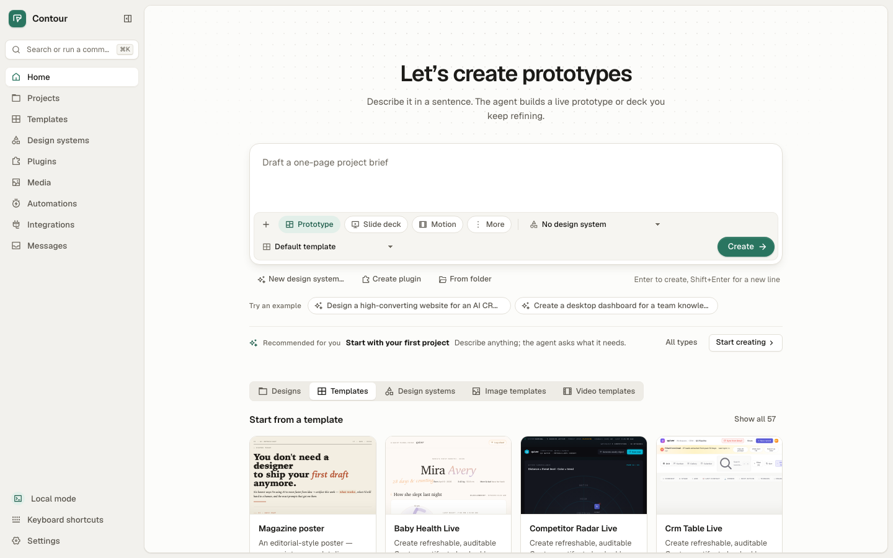

<p></p>

**Contour — a local-first AI design studio.** Rust rewrite of
[OpenDesign](https://github.com/nexu-io/open-design); no account, no cloud.

[](https://github.com/quangphung218/contour-design/actions/workflows/ci.yml)
[](https://github.com/quangphung218/contour-design/releases)
[](LICENSE)

Contour turns a brief into a design: web pages, prototypes, slide decks,
documents, images and video. A coding agent you already have (Claude Code,
Codex, Cursor, Copilot and a dozen more) writes HTML into a project folder; Contour
shows the live preview, lets you comment on and edit it directly, keeps a
version history and exports to HTML, PDF, PPTX, PNG and MP4. Everything runs
on your machine: no sign-in, no cloud, no telemetry.

<p></p>

## Features

- **Bring your own agent.** 6 coding-agent CLIs and 10 ACP agents are
  detected on `PATH`; no agent? Use an API key (26 BYOK presets).
- **Studio.** Streaming chat, live sandboxed preview, comments pinned to
  elements, direct text and style edits written back to the source, tweaks,
  palette swap, anti-slop lint, version history, decks with presenter mode,
  terminal tabs.
- **Content included.** 169 skills, 115 design templates and 152 design
  systems from OpenDesign; create your own design system from a brand
  description, a URL or a `DESIGN.md`.
- **Export.** Self-contained HTML, ZIP, PDF (raster or vector), PNG/JPEG,
  PPTX (images or editable shapes), MP4, React component as HTML.
- **Automate and integrate.** Cron routines, an MCP server for your other
  agents (`od mcp install claude`), external MCP servers for Contour's
  agents, and a CLI for everything the UI does.
- **20 languages**, light and dark themes, keyboard shortcuts, a command
  palette.

<table>
<tr>
<td></td>
<td></td>
</tr>
</table>

The full tour is in [docs/features.md](docs/features.md).

## Install

### Download

Get the latest build from
[Releases](https://github.com/quangphung218/contour-design/releases): a
universal `.dmg` for macOS, an `.AppImage` or `.deb` for Linux, and an
`.msi` for Windows (untested). Each release has a `SHA256SUMS` file. Builds
without a signing certificate are unsigned; see
[getting started](docs/getting-started.md#download-a-release) for opening
them on macOS.

### Build from source

Needs Rust 1.85+, Node.js 20+ and `trunk`; `make setup` checks and tells you
what is missing.

```bash
git clone https://github.com/quangphung218/contour-design.git
cd contour-design
make setup
make app-release && make install     # Contour.app in /Applications (macOS)
```

Or run the daemon and use the UI in a browser: `make run`, then open
`http://127.0.0.1:7456`.

## Quickstart

1. **Install an agent** and sign in to it once, for example
   `npm install -g @anthropic-ai/claude-code && claude`. (Or have an API
   key ready.)
2. **Open Contour** and pick the agent it found (or choose *API key*).
3. **Type a brief** on Home, such as *"Landing page for a tea shop, warm
   colours"*, and press Enter. Watch the preview fill in, comment on what to
   change, then **Export**.

More in [docs/getting-started.md](docs/getting-started.md).

## Compared with OpenDesign

Contour is a rewrite of OpenDesign in Rust (axum daemon, Leptos/WASM UI,
Tauri 2 shell) that keeps its behaviour, content and prompts. It reaches
**207 of 207** scored features of the original app; 20 features that need an
account, a cloud service or outbound network (connectors, marketplace, team
sharing, cloud deploy, auto-update…) are deliberately left out. The
row-by-row comparison with evidence is in [docs/parity.md](docs/parity.md),
and the choices behind it in [docs/decisions.md](docs/decisions.md).

## Known limitations

- **Windows is not tested.** Job Objects, ConPTY and the WebView2 app only
  pass a compile check; CI builds it but runs no tests.
- **External MCP servers reach Claude, ACP agents and OpenCode only**, as in
  the original app; ACP takes stdio servers only.
- **Fully detached processes can survive.** An MCP stdio helper that
  double-forks, or a terminal job that calls `setsid` and loses its parent
  within 2 seconds, is not killed when its tab or the daemon stops; macOS
  has no subreaper to prevent it.
- **Direct text editing applies to text-only elements.** Elements with child
  tags or generated by scripts answer 409 with the reason.
- **No auto-update.** Download the new release, or `git pull` and rebuild.
- **Export to PDF, images, PPTX and MP4 needs Chrome, Edge or Chromium**
  already installed; Contour never downloads a browser.

## Documentation

| For | Read |
|---|---|
| Using Contour | [Getting started](docs/getting-started.md), [Features](docs/features.md), [Troubleshooting](docs/troubleshooting.md) |
| Contributing | [CONTRIBUTING.md](CONTRIBUTING.md), [Development](docs/development.md), [Architecture](docs/architecture.md), [Release process](docs/release.md) |
| Design | [Spec](docs/spec.md), [Decisions](docs/decisions.md), [Design system](docs/design-system.md), [Brand](docs/brand.md) |
| Status | [Parity with OpenDesign](docs/parity.md), [Changelog](CHANGELOG.md) |
| Security | [SECURITY.md](SECURITY.md) |

## License and credits

Contour is licensed under the [Apache License 2.0](LICENSE), like
OpenDesign. It is built on OpenDesign by nexu-io and contributors: skills,
design templates, design systems, craft guides, plugins and prompt texts come
from OpenDesign (commit `e03d5c2`) and keep their own licences and
attribution. Bundled third-party code (xterm.js, React, Sucrase, Remix Icon,
Geist) and every licence are listed in [NOTICE](NOTICE).
