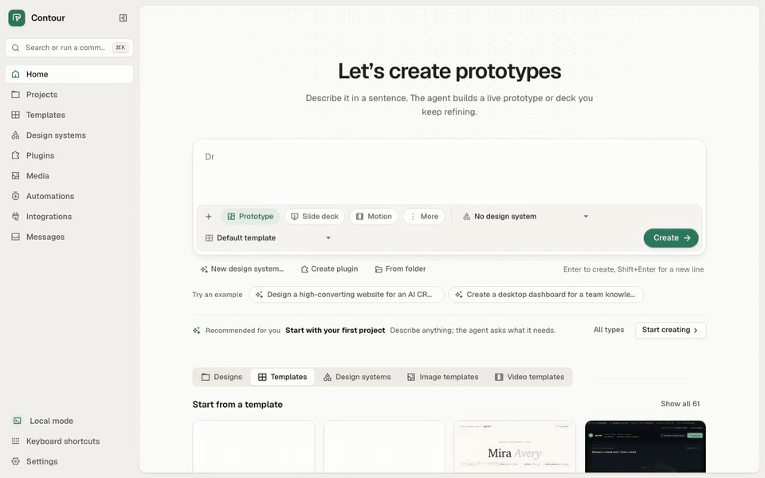
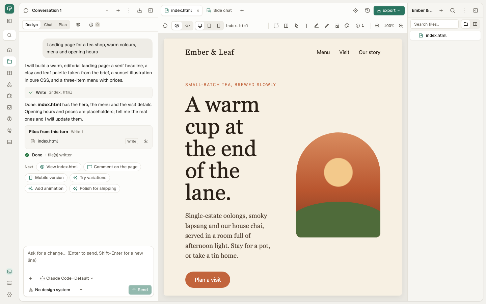
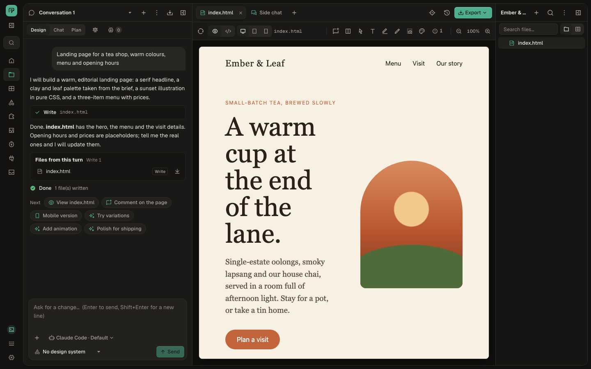

<p align="center">
  <picture>
    <source media="(prefers-color-scheme: dark)" srcset="assets/brand/contour-wordmark-dark.svg">
    
  </picture>
</p>

<p align="center">
  <b>English</b> · <a href="README.vi.md">Tiếng Việt</a>
</p>

<p align="center">
  <b>A local-first AI design studio that works with the coding agent you already have, with no account and no telemetry.</b><br>
  Describe a page, a deck, a document or a short film; your agent writes it into a project folder on your machine.<br>
  Contour shows it live, lets you comment on it and edit it, keeps every version and exports it.
</p>

<p align="center">
  <a href="https://github.com/quangphung218/contour-design/actions/workflows/ci.yml"></a>
  <a href="https://github.com/quangphung218/contour-design/releases"></a>
  
  
  <a href="LICENSE"></a>
</p>

<p align="center">
  <a href="#downloads"><b>Download Contour</b></a> ·
  <a href="#how-it-works">How it works</a> ·
  <a href="#status">Status</a> ·
  <a href="#privacy">Privacy</a> ·
  <a href="#how-is-this-different-from-opendesign">vs OpenDesign</a> ·
  <a href="#known-limitations">Limitations</a> ·
  <a href="#documentation">Docs</a>
</p>

<p align="center">
  
  <br>
  <sub>A scripted demo: a stand-in agent replays the same reply each time so the recording is repeatable; a real agent writes its own page.</sub>
</p>

<table>
  <tr>
    <td width="25%" valign="top">
      <h3>Bring your own agent</h3>
      Contour finds 25 coding-agent CLIs on your <code>PATH</code> (Claude Code, Codex, Cursor, Copilot, OpenCode, Qwen Code and ACP agents such as Kimi and Kiro). No agent? Use an API key with one of 28 provider presets.
    </td>
    <td width="25%" valign="top">
      <h3>See it, comment, edit</h3>
      A sandboxed live preview reloads as files change. Pin a comment on any element for the next turn, or edit text and style by hand: the change is written back to the source file.
    </td>
    <td width="25%" valign="top">
      <h3>Every version kept</h3>
      Each HTML page keeps its history in the project folder: what the agent wrote, what you edited and what you restored. Open any saved version and restore it.
    </td>
    <td width="25%" valign="top">
      <h3>Export anywhere</h3>
      8 export formats: self-contained HTML, project ZIP, PDF (raster or vector), PNG/JPEG, PPTX (images or editable shapes) and MP4. 169 skills, 174 templates and 152 design systems are included.
    </td>
  </tr>
</table>

## How it works

1. **Install** Contour from [Downloads](#downloads) (macOS, Windows, Ubuntu), or build it from source.
2. **Connect an agent.** Install one and sign in to it once, for example
   `npm install -g @anthropic-ai/claude-code && claude`. Contour finds it and tests it; or pick *API key*.
3. **Describe what you want** on Home, such as *"Landing page for a tea shop, warm colours"*, and press Enter.
   Watch the preview fill in, then comment on what to change or edit it yourself.
4. **Export** to HTML, PDF, PPTX, PNG or MP4 from the Export menu.

<table>
  <tr>
    <td width="50%" valign="top">
      <br>
      <sub><b>Studio:</b> chat on the left, live preview on the right.</sub>
    </td>
    <td width="50%" valign="top">
      <br>
      <sub><b>Dark mode:</b> the same project, in 1 of 20 UI languages and two themes.</sub>
    </td>
  </tr>
</table>

The full tour (studio, decks, terminal tabs, routines, MCP server, the `od` CLI) is in
[docs/features.md](docs/features.md); step by step in [docs/getting-started.md](docs/getting-started.md).

## Status

> [!IMPORTANT]
> **Contour is in beta:** `0.2.0-beta.N` pre-releases, published since 26 October 2026. What works, what
> is partial and what is next:
>
> - **Works today:** the desktop app on macOS, Windows and Ubuntu; the main flow (agent → design → comment
>   and edit → export) with Claude Code, checked by hand on the released macOS build; every scored feature
>   of OpenDesign that needs no account or cloud; the `od` CLI and MCP server.
> - **Partly there:** Windows and Linux are checked by automated smoke tests, not by a person each release;
>   other agents are tested against stand-ins, not each one live; the builds have no Developer ID or
>   Windows code signing.
> - **Next:** a person's run of the main flow on Windows and Ubuntu, and Update now from the previous
>   release checked by hand on each system (CI cannot check it).
>
> [docs/STATUS.md](docs/STATUS.md) lists each part and how it was checked. Found something broken?
> [Open an issue](https://github.com/quangphung218/contour-design/issues).

## Downloads

Every build is on the [Releases page](https://github.com/quangphung218/contour-design/releases); betas
are pre-releases. `<version>` is the version number, for example `0.2.0-beta.50`.

| System | File | Install |
|---|---|---|
| macOS 13.3 or later, Apple silicon and Intel | `Contour_<version>_universal.dmg` | Drag Contour to Applications, then [allow it once](#first-open-on-macos) |
| Ubuntu 22.04 LTS or 24.04 LTS, x64 | `Contour_<version>_amd64.deb` | `sudo apt install ./Contour_<version>_amd64.deb` ([details](docs/getting-started.md#install-on-ubuntu)) |
| | `Contour_<version>_amd64.AppImage` | Make it executable and run it |
| Windows 10 and 11, x64 | `Contour_<version>_x64_en-US.msi` | SmartScreen asks once: **More info ▸ Run anyway** ([details](docs/getting-started.md#install-on-windows)) |

The other files are for **Update now** in the app: `Contour_<version>_universal.app.tar.gz`, the `.sig`
signatures and `latest.json`. `SHA256SUMS` lists a checksum for every file. In the download folder:

```sh
shasum -a 256 --ignore-missing -c SHA256SUMS     # macOS: each file you have prints "OK"
sha256sum --ignore-missing -c SHA256SUMS         # Linux
```

### First open on macOS

The macOS build is signed **ad-hoc**, without an Apple Developer ID, so the first launch says
**"“Contour” Not Opened"** ("Apple could not verify “Contour” is free of malware…"). Click **Done**, then
run this once in Terminal:

```sh
xattr -dr com.apple.quarantine /Applications/Contour.app
```

Or without Terminal: on macOS 15 and later, **System Settings ▸ Privacy & Security ▸ Open Anyway**; on
macOS 13.3 to 14, Control-click the app ▸ **Open**
([step by step](docs/getting-started.md#open-a-build-without-developer-id-on-macos)).

**Check the signature.** The ad-hoc signature seals the whole app, so macOS keeps a permission such as
Documents access once you allow it:

```sh
codesign --verify --deep --strict --verbose=2 /Applications/Contour.app
# /Applications/Contour.app: valid on disk
# /Applications/Contour.app: satisfies its Designated Requirement

codesign -dv /Applications/Contour.app 2>&1 | grep -E 'Signature|Sealed'
# Signature=adhoc
# Sealed Resources version=2 …
```

Any other output means the app was changed after it was built: download it again.

### Build from source

Needs Rust 1.89+, Node.js 20+ and `trunk`; `make setup` checks and says what is missing.

```sh
git clone https://github.com/quangphung218/contour-design.git
cd contour-design
make setup
make app-release && make install     # Contour.app in /Applications (macOS)
```

Or run the daemon and use the UI in a browser: `make run`, then open `http://127.0.0.1:7456`.

## Privacy

**No telemetry, no account, no cloud.** No analytics, crash-reporting or tracing client is in the code or
its dependencies. Nothing leaves your machine except calls to the services you configure: your agent or
model provider, and any MCP server, media or research provider you add.

**Updates only when you click.** Help ▸ Check for Updates asks GitHub Releases for the newest version,
sending nothing but its User-Agent, and never checks in the background. Update now downloads and
installs that release's signed build, also only when you click it.

## How is this different from OpenDesign?

Contour started as a Rust rewrite of [OpenDesign](https://github.com/nexu-io/open-design) and keeps its
behaviour, content and prompts.

| | Contour | OpenDesign |
|---|---|---|
| Telemetry | None | On by default, can be turned off in part |
| Account and cloud | None | Optional cloud with sign-in |
| Built with | Rust: axum daemon, Leptos/WASM UI, Tauri 2 shell | TypeScript: Node daemon, Next.js UI, Electron shell |
| Features | 206 of 206 scored features; the 20 that need an account, a cloud service or outbound network are left out on purpose | All, including the cloud features |

Each row with its source (OpenDesign as of commit `e03d5c2`) is in
[docs/parity.md](docs/parity.md#how-contour-differs), the row-by-row feature comparison below it, and the
choices behind it in [docs/decisions.md](docs/decisions.md).

## Known limitations

- **Platforms:** macOS 13.3+, Windows 10/11 x64 and Ubuntu 22.04/24.04 x64 only; no ARM build for Windows
  or Linux. Other Linux distributions are not tested.
- **No Developer ID or Windows code signing:** macOS and Windows ask once on first open (see above).
- **Export to PDF, images, PPTX and MP4 needs Chrome, Edge or Chromium** already installed; Contour never
  downloads a browser. MP4 also needs `ffmpeg`.
- **No background auto-update.** The `.deb` and source builds cannot update themselves.
- **External MCP servers reach Claude, ACP agents and OpenCode only**, as in OpenDesign.

The rest (direct text editing limits, detached processes, Wayland) is in
[docs/STATUS.md](docs/STATUS.md#known-limitations).

## Documentation

| For | Read |
|---|---|
| Using Contour | [Getting started](docs/getting-started.md), [Features](docs/features.md), [Troubleshooting](docs/troubleshooting.md) |
| What works | [Status](docs/STATUS.md), [Parity with OpenDesign](docs/parity.md), [Changelog](CHANGELOG.md) |
| Contributing | [CONTRIBUTING.md](CONTRIBUTING.md), [Development](docs/development.md), [Architecture](docs/architecture.md), [Release process](docs/release.md) |
| Design | [Spec](docs/spec.md), [Decisions](docs/decisions.md), [Design system](docs/design-system.md), [Brand](docs/brand.md) |
| Security | [SECURITY.md](SECURITY.md) |

## License and credits

Contour is licensed under the [Apache License 2.0](LICENSE), like OpenDesign. It is built on OpenDesign by
nexu-io and contributors: skills, design templates, design systems, craft guides, plugins and prompt texts
come from OpenDesign (commit `e03d5c2`) and keep their own licences and attribution. [NOTICE](NOTICE) lists
the bundled third-party code and the files Contour changed; [THIRD-PARTY-LICENSES](THIRD-PARTY-LICENSES)
holds the licence text of every Rust crate and vendored asset (`make licenses`). The app shows both in
Settings ▸ About ▸ Licenses.

**Trademarks.** 90 of the 152 design systems are named after a real company or product (Airbnb, Apple,
Stripe…). Each is inspired by that brand's public design language; Contour is not affiliated with or
endorsed by any of them. Claude Code, Codex, Cursor, Copilot and other names are trademarks of their
owners.
