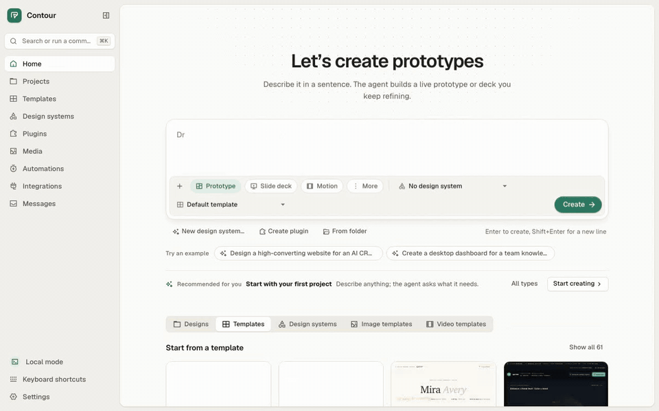
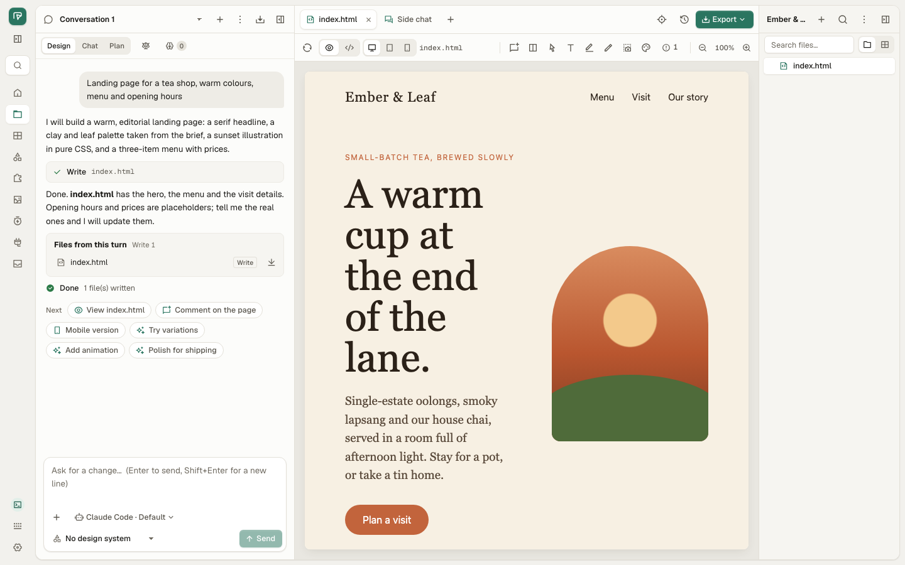
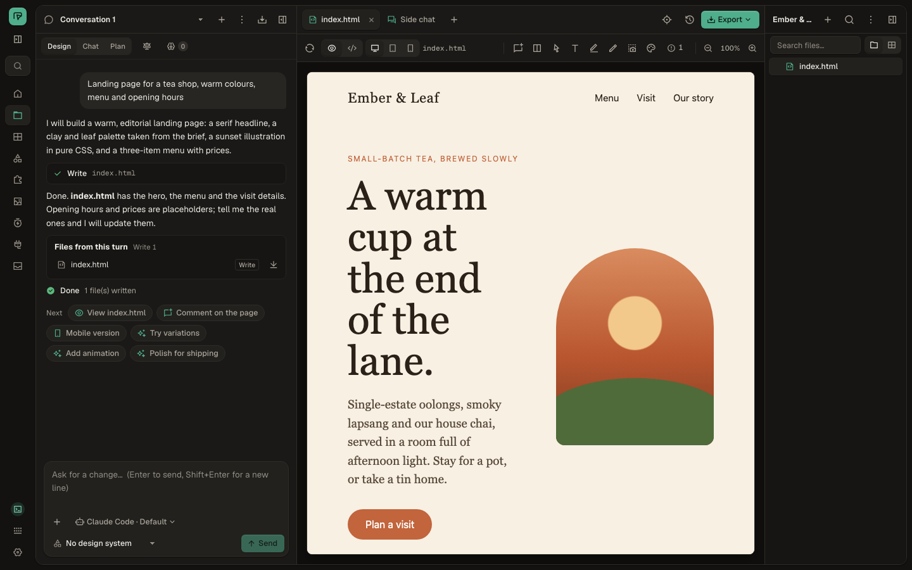

<p></p>

**Contour is a local-first AI design studio with no telemetry.** It runs
entirely on your machine and works with the coding agent CLI you already
have: Claude Code, Codex, Cursor, Copilot and a dozen more. No account, no
cloud; nothing leaves your machine except calls to the services you
configure: your agent or model provider, and any MCP server, media or
research provider you add.

[](https://github.com/quangphung218/contour-design/actions/workflows/ci.yml)
[](https://github.com/quangphung218/contour-design/releases)
[](LICENSE)

<p></p>

<sub>Recorded with a scripted stand-in agent so the run is repeatable; a real
agent writes its own page.</sub>

Type a brief and your agent writes HTML into a project folder; Contour shows
the live preview, lets you comment on and edit it directly, keeps a version
history and exports to HTML, PDF, PPTX, PNG and MP4. Web pages, prototypes,
slide decks, documents, images and video all work the same way.

## Features

- **Bring your own agent.** 6 coding-agent CLIs and 10 ACP agents are
  detected on `PATH`; no agent? Use an API key (26 BYOK presets).
- **Studio.** Streaming chat, live sandboxed preview, comments pinned to
  elements, direct text and style edits written back to the source, tweaks,
  palette swap, anti-slop lint, version history, decks with presenter mode,
  terminal tabs.
- **Content included.** 169 skills, 115 design templates and 152 design
  systems from OpenDesign; create your own design system from a brand
  description, a URL or a `DESIGN.md`.
- **Export.** Self-contained HTML, ZIP, PDF (raster or vector), PNG/JPEG,
  PPTX (images or editable shapes), MP4, React component as HTML.
- **Automate and integrate.** Cron routines, an MCP server for your other
  agents (`od mcp install claude`), external MCP servers for Contour's
  agents, and a CLI for everything the UI does.
- **20 languages**, light and dark themes, keyboard shortcuts, a command
  palette.

<table>
<tr>
<td></td>
<td></td>
</tr>
</table>

The full tour is in [docs/features.md](docs/features.md).

## Install

### Download

Get the latest build from
[Releases](https://github.com/quangphung218/contour-design/releases): a
universal `.dmg` for macOS, an `.AppImage` or `.deb` for Linux, and an
`.msi` for Windows (untested). Each release has a `SHA256SUMS` file.

Builds without a signing certificate are unsigned, and macOS stops them the
first time. On **macOS 15 and later**, open Contour once, then go to
**System Settings ▸ Privacy & Security ▸ Open Anyway** and open it again.
On macOS 14 and earlier, Control-click the app ▸ **Open**. Step by step:
[getting started](docs/getting-started.md#open-an-unsigned-build-on-macos).

### Build from source

Needs Rust 1.85+, Node.js 20+ and `trunk`; `make setup` checks and tells you
what is missing.

```bash
git clone https://github.com/quangphung218/contour-design.git
cd contour-design
make setup
make app-release && make install     # Contour.app in /Applications (macOS)
```

Or run the daemon and use the UI in a browser: `make run`, then open
`http://127.0.0.1:7456`.

## Quickstart

1. **Install an agent** and sign in to it once, for example
   `npm install -g @anthropic-ai/claude-code && claude`. (Or have an API
   key ready.)
2. **Open Contour** and pick the agent it found (or choose *API key*).
3. **Type a brief** on Home, such as *"Landing page for a tea shop, warm
   colours"*, and press Enter. Watch the preview fill in, comment on what to
   change, then **Export**.

More in [docs/getting-started.md](docs/getting-started.md).

## How is this different from OpenDesign?

Contour started as a Rust rewrite of
[OpenDesign](https://github.com/nexu-io/open-design) and keeps its
behaviour, content and prompts. What differs, with the source for each
claim (OpenDesign as of commit `e03d5c2`):

| | Contour | OpenDesign |
|---|---|---|
| Telemetry | None. No analytics, crash-reporting or tracing client is in the code or its dependencies, and the end-to-end tests block every request the UI makes off the machine. | Product analytics and quality traces are on by default and can be turned off; safety and reliability telemetry is always enabled in builds configured with a telemetry destination ([PRIVACY.md](https://github.com/nexu-io/open-design/blob/e03d5c23f308c39f4de7c057568df66c29a84385/PRIVACY.md)). |
| Account and cloud | None. Nothing to sign in to. | Optional OpenDesign Cloud with sign-in and its own model service ([README](https://github.com/nexu-io/open-design/blob/e03d5c23f308c39f4de7c057568df66c29a84385/README.md)). |
| Network | Only the services you configure: your agent or model provider, and any MCP server, media or research provider you add. Contour never downloads a browser or updates itself. | Also its cloud, sharing and deploy services when you use them. |
| Built with | Rust: axum daemon, Leptos/WASM UI, Tauri 2 shell. | TypeScript: Node daemon, Next.js UI, Electron shell. |
| Features | **207 of 207** scored features of OpenDesign. The 20 that need an account, a cloud service or outbound network (connectors, marketplace, team sharing, cloud deploy, auto-update…) are left out on purpose. | All of them, including the cloud features. |

The row-by-row feature comparison with evidence is in
[docs/parity.md](docs/parity.md), and the choices behind it in
[docs/decisions.md](docs/decisions.md).

## Known limitations

- **Windows is not tested.** Job Objects, ConPTY and the WebView2 app only
  pass a compile check; CI builds it but runs no tests.
- **Windows may not find an installed agent.** Detection looks for the bare
  name (`claude`), not `claude.exe`, and the install folders Check again
  adds hang off `HOME`, which Windows usually does not set; a restart does
  not help. Onboarding on Windows therefore links each agent's setup page
  and the API key path, with no install command or Check again.
- **External MCP servers reach Claude, ACP agents and OpenCode only**, as in
  the original app; ACP takes stdio servers only.
- **Fully detached processes can survive.** An MCP stdio helper that
  double-forks, or a terminal job that calls `setsid` and loses its parent
  within 2 seconds, is not killed when its tab or the daemon stops; macOS
  has no subreaper to prevent it.
- **Direct text editing applies to text-only elements.** Elements with child
  tags or generated by scripts answer 409 with the reason.
- **No auto-update.** Download the new release, or `git pull` and rebuild.
- **Export to PDF, images, PPTX and MP4 needs Chrome, Edge or Chromium**
  already installed; Contour never downloads a browser.

## Documentation

| For | Read |
|---|---|
| Using Contour | [Getting started](docs/getting-started.md), [Features](docs/features.md), [Troubleshooting](docs/troubleshooting.md) |
| Contributing | [CONTRIBUTING.md](CONTRIBUTING.md), [Development](docs/development.md), [Architecture](docs/architecture.md), [Release process](docs/release.md) |
| Design | [Spec](docs/spec.md), [Decisions](docs/decisions.md), [Design system](docs/design-system.md), [Brand](docs/brand.md) |
| Status | [Parity with OpenDesign](docs/parity.md), [Changelog](CHANGELOG.md) |
| Security | [SECURITY.md](SECURITY.md) |

## License and credits

Contour is licensed under the [Apache License 2.0](LICENSE), like
OpenDesign. It is built on OpenDesign by nexu-io and contributors: skills,
design templates, design systems, craft guides, plugins and prompt texts come
from OpenDesign (commit `e03d5c2`) and keep their own licences and
attribution. Bundled third-party code (xterm.js, React, Sucrase, Remix Icon,
Geist) are listed in [NOTICE](NOTICE); the files Contour changed from
OpenDesign are listed there too. [THIRD-PARTY-LICENSES](THIRD-PARTY-LICENSES)
holds the licence texts of every Rust crate and vendored asset in the app,
generated from `Cargo.lock` by `make licenses`. The app ships all three files
and shows them in Settings ▸ About ▸ Licenses.

**Trademarks.** 90 of the bundled design systems are named after a real
company or product (Airbnb, Apple, Stripe…). Each is inspired by that
brand's public design language; Contour is not affiliated with or endorsed by
any of them, and all trademarks belong to their owners. The app shows this
note on each one's page, and [NOTICE](NOTICE) lists them.

Claude Code, Codex, Cursor, Copilot and other names are trademarks of their
owners; Contour is not affiliated with them.
