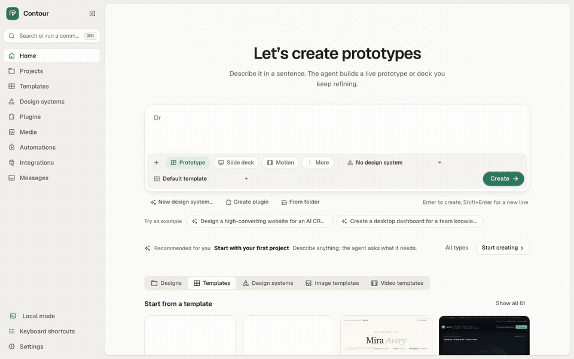
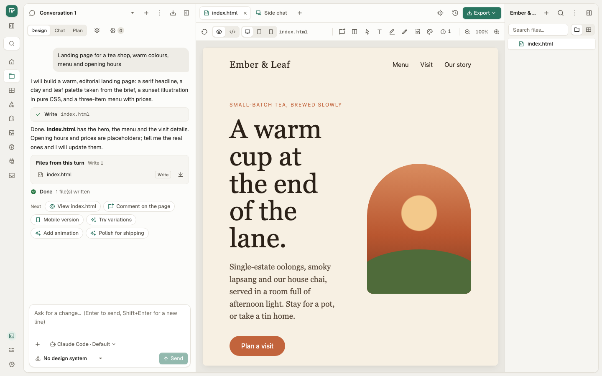
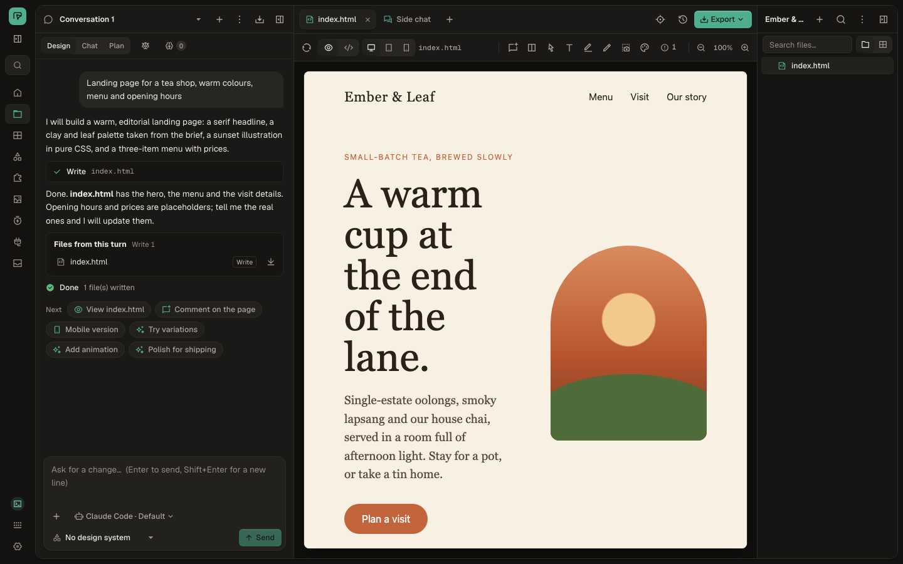

<p align="center">
  <picture>
    <source media="(prefers-color-scheme: dark)" srcset="assets/brand/contour-wordmark-dark.svg">
    
  </picture>
</p>

<p align="center">
  <a href="README.md">English</a> · <b>Tiếng Việt</b>
</p>

<p align="center">
  <b>Studio thiết kế AI chạy trên máy, dùng chính coding agent đang có, không cần tài khoản, không telemetry.</b><br>
  Mô tả một trang web, một bộ slide, một tài liệu hay một đoạn phim ngắn; agent viết nó vào thư mục project trên máy.<br>
  Contour hiện bản xem trước trực tiếp, cho comment và sửa tay, giữ mọi phiên bản và export ra file.
</p>

<p align="center">
  <a href="https://github.com/quangphung218/contour-design/actions/workflows/ci.yml"></a>
  <a href="https://github.com/quangphung218/contour-design/releases"></a>
  
  
  <a href="LICENSE"></a>
</p>

<p align="center">
  <a href="#tải-về"><b>Tải Contour</b></a> ·
  <a href="#cách-hoạt-động">Cách hoạt động</a> ·
  <a href="#trạng-thái">Trạng thái</a> ·
  <a href="#quyền-riêng-tư">Quyền riêng tư</a> ·
  <a href="#khác-gì-opendesign">So với OpenDesign</a> ·
  <a href="#giới-hạn-đã-biết">Giới hạn</a> ·
  <a href="#tài-liệu">Tài liệu</a>
</p>

<p align="center">
  
  <br>
  <sub>Demo dựng sẵn: một agent giả phát lại cùng một câu trả lời để lần quay nào cũng giống nhau; agent thật sẽ tự viết trang của nó.</sub>
</p>

<table>
  <tr>
    <td width="25%" valign="top">
      <h3>Dùng agent sẵn có</h3>
      Contour tìm 25 coding-agent CLI trên <code>PATH</code> (Claude Code, Codex, Cursor, Copilot, OpenCode, Qwen Code và các ACP agent như Kimi, Kiro). Không có agent thì dùng API key với một trong 28 preset nhà cung cấp.
    </td>
    <td width="25%" valign="top">
      <h3>Xem, comment, sửa</h3>
      Bản xem trước chạy trong sandbox, tự tải lại khi file đổi. Comment gắn vào từng phần tử cho lượt sau, hoặc sửa chữ và style bằng tay: thay đổi được ghi ngược vào file nguồn.
    </td>
    <td width="25%" valign="top">
      <h3>Giữ mọi phiên bản</h3>
      Mỗi trang HTML có lịch sử riêng trong thư mục project: bản agent viết, bản sửa tay, bản đã khôi phục. Mở bản nào cũng được và khôi phục lại.
    </td>
    <td width="25%" valign="top">
      <h3>Export đủ định dạng</h3>
      8 định dạng export: HTML tự chứa, ZIP cả project, PDF (raster hoặc vector), PNG/JPEG, PPTX (ảnh hoặc shape sửa được) và MP4. Có sẵn 169 skill, 174 template và 152 design system.
    </td>
  </tr>
</table>

## Cách hoạt động

1. **Cài** Contour từ mục [Tải về](#tải-về) (macOS, Windows, Ubuntu), hoặc build từ source.
2. **Kết nối agent.** Cài một agent và đăng nhập một lần, ví dụ
   `npm install -g @anthropic-ai/claude-code && claude`. Contour tự tìm và chạy thử; hoặc chọn *API key*.
3. **Mô tả thứ cần làm** ở Home, ví dụ *"Landing page cho tiệm trà, tông màu ấm"*, rồi nhấn Enter.
   Bản xem trước hiện dần; sau đó comment chỗ cần đổi hoặc tự sửa.
4. **Export** ra HTML, PDF, PPTX, PNG hoặc MP4 từ menu Export.

<table>
  <tr>
    <td width="50%" valign="top">
      <br>
      <sub><b>Studio:</b> chat bên trái, bản xem trước bên phải.</sub>
    </td>
    <td width="50%" valign="top">
      <br>
      <sub><b>Chế độ tối:</b> cùng project; giao diện có 20 ngôn ngữ và hai theme.</sub>
    </td>
  </tr>
</table>

Toàn bộ tính năng (studio, slide, terminal tab, routine, MCP server, CLI `od`) có trong
[docs/features.md](docs/features.md) (tiếng Anh); từng bước có trong [docs/getting-started.md](docs/getting-started.md).

## Trạng thái

> [!IMPORTANT]
> **Contour đang ở giai đoạn beta:** các bản pre-release `0.2.0-beta.N`, phát hành từ 26/10/2026. Phần đã
> chạy được, phần mới xong một phần và phần tiếp theo:
>
> - **Đã chạy được:** app desktop trên macOS, Windows và Ubuntu; luồng chính (agent → thiết kế → comment
>   và sửa → export) với Claude Code, đã kiểm tay trên bản macOS phát hành; mọi tính năng được chấm điểm
>   của OpenDesign mà không cần tài khoản hay cloud; CLI `od` và MCP server.
> - **Mới xong một phần:** Windows và Linux được kiểm bằng smoke test tự động, chưa có người kiểm tay mỗi
>   bản; các agent khác được test với bản giả, chưa chạy thật từng cái; bản build chưa có Developer ID
>   hay chữ ký code cho Windows.
> - **Tiếp theo:** beta.51, bản phát hành hằng tuần vào thứ Hai 23/11: hộp thoại hỏi trước khi thoát làm
>   dừng các agent đang chạy (QA-114), và gợi ý bước tiếp theo lấy từ chính lượt vừa xong.
>
> [docs/STATUS.md](docs/STATUS.md) liệt kê từng phần và cách đã kiểm. Gặp lỗi thì
> [mở issue](https://github.com/quangphung218/contour-design/issues).

## Tải về

Mọi bản build có trên [trang Releases](https://github.com/quangphung218/contour-design/releases); bản beta
là pre-release. `<version>` là số phiên bản, ví dụ `0.2.0-beta.50`.

| Hệ điều hành | File | Cài đặt |
|---|---|---|
| macOS 13.3 trở lên, Apple silicon và Intel | `Contour_<version>_universal.dmg` | Kéo Contour vào Applications, rồi [cho phép một lần](#mở-lần-đầu-trên-macos) |
| Ubuntu 22.04 LTS hoặc 24.04 LTS, x64 | `Contour_<version>_amd64.deb` | `sudo apt install ./Contour_<version>_amd64.deb` ([chi tiết](docs/getting-started.md#install-on-ubuntu)) |
| | `Contour_<version>_amd64.AppImage` | Cấp quyền chạy rồi mở file |
| Windows 10 và 11, x64 | `Contour_<version>_x64_en-US.msi` | SmartScreen hỏi một lần: **More info ▸ Run anyway** ([chi tiết](docs/getting-started.md#install-on-windows)) |

Các file còn lại dành cho **Update now** trong app: `Contour_<version>_universal.app.tar.gz`, các chữ ký
`.sig` và `latest.json`. `SHA256SUMS` chứa checksum của mọi file. Trong thư mục đã tải về:

```sh
shasum -a 256 --ignore-missing -c SHA256SUMS     # macOS: mỗi file đã tải in ra "OK"
sha256sum --ignore-missing -c SHA256SUMS         # Linux
```

### Mở lần đầu trên macOS

Bản macOS được ký **ad-hoc**, không có Apple Developer ID, nên lần mở đầu macOS báo
**"“Contour” Not Opened"** ("Apple could not verify “Contour” is free of malware…"). Bấm **Done**, rồi
chạy lệnh sau một lần trong Terminal:

```sh
xattr -dr com.apple.quarantine /Applications/Contour.app
```

Cách không cần Terminal: macOS 15 trở lên vào **System Settings ▸ Privacy & Security ▸ Open Anyway**;
macOS 13.3 đến 14 thì Control-click vào app ▸ **Open**
([từng bước](docs/getting-started.md#open-a-build-without-developer-id-on-macos)).

**Kiểm chữ ký.** Chữ ký ad-hoc niêm phong toàn bộ app, nên macOS giữ quyền đã cấp (ví dụ quyền đọc
Documents) sau lần cho phép đầu tiên:

```sh
codesign --verify --deep --strict --verbose=2 /Applications/Contour.app
# /Applications/Contour.app: valid on disk
# /Applications/Contour.app: satisfies its Designated Requirement

codesign -dv /Applications/Contour.app 2>&1 | grep -E 'Signature|Sealed'
# Signature=adhoc
# Sealed Resources version=2 …
```

Kết quả khác nghĩa là app đã bị sửa sau khi build: cần tải lại.

### Build từ source

Cần Rust 1.89+, Node.js 20+ và `trunk`; `make setup` kiểm tra và báo thiếu gì.

```sh
git clone https://github.com/quangphung218/contour-design.git
cd contour-design
make setup
make app-release && make install     # Contour.app trong /Applications (macOS)
```

Hoặc chạy daemon và dùng giao diện trên trình duyệt: `make run`, rồi mở `http://127.0.0.1:7456`.

## Quyền riêng tư

**Không telemetry, không tài khoản, không cloud.** Code và các dependency không có client analytics, báo
crash hay tracing nào. Không gì rời khỏi máy, trừ các lời gọi tới dịch vụ đã cấu hình: agent hoặc nhà
cung cấp model, và MCP server, nhà cung cấp media hay research được thêm vào.

**Chỉ cập nhật khi bấm.** Help ▸ Check for Updates hỏi GitHub Releases về bản mới nhất, chỉ gửi
User-Agent, và không bao giờ tự kiểm tra ngầm. Update now tải và cài bản build đã ký của release đó,
cũng chỉ khi bấm.

## Khác gì OpenDesign?

Contour bắt đầu là bản viết lại bằng Rust của [OpenDesign](https://github.com/nexu-io/open-design), giữ
nguyên hành vi, nội dung và prompt.

| | Contour | OpenDesign |
|---|---|---|
| Telemetry | Không có | Bật mặc định, tắt được một phần |
| Tài khoản và cloud | Không có | Cloud tuỳ chọn, có đăng nhập |
| Công nghệ | Rust: daemon axum, UI Leptos/WASM, shell Tauri 2 | TypeScript: daemon Node, UI Next.js, shell Electron |
| Tính năng | 206 trên 206 tính năng được chấm điểm; 20 tính năng cần tài khoản, dịch vụ cloud hay mạng ngoài được bỏ có chủ đích | Đủ cả, gồm tính năng cloud |

Từng dòng kèm nguồn (OpenDesign tại commit `e03d5c2`) có trong
[docs/parity.md](docs/parity.md#how-contour-differs), bảng so sánh từng tính năng nằm ngay dưới, và lý do
từng lựa chọn có trong [docs/decisions.md](docs/decisions.md).

## Giới hạn đã biết

- **Nền tảng:** chỉ macOS 13.3+, Windows 10/11 x64 và Ubuntu 22.04/24.04 x64; chưa có bản ARM cho Windows
  hay Linux. Các bản Linux khác chưa được test.
- **Chưa có Developer ID hay chữ ký code Windows:** macOS và Windows hỏi một lần khi mở lần đầu (xem trên).
- **Export PDF, ảnh, PPTX và MP4 cần Chrome, Edge hoặc Chromium** cài sẵn; Contour không bao giờ tự tải
  trình duyệt. MP4 cần thêm `ffmpeg`.
- **Không tự cập nhật ngầm.** Bản `.deb` và bản build từ source không tự cập nhật được.
- **MCP server ngoài chỉ tới được Claude, ACP agent và OpenCode**, giống OpenDesign.

Phần còn lại (giới hạn sửa chữ trực tiếp, process tách hẳn, Wayland) có trong
[docs/STATUS.md](docs/STATUS.md#known-limitations).

## Tài liệu

Tài liệu trong `docs/` viết bằng tiếng Anh.

| Cho | Đọc |
|---|---|
| Dùng Contour | [Getting started](docs/getting-started.md), [Features](docs/features.md), [Troubleshooting](docs/troubleshooting.md) |
| Đã chạy được gì | [Status](docs/STATUS.md), [Parity với OpenDesign](docs/parity.md), [Changelog](CHANGELOG.md) |
| Đóng góp | [CONTRIBUTING.md](CONTRIBUTING.md), [Development](docs/development.md), [Architecture](docs/architecture.md), [Quy trình release](docs/release.md) |
| Thiết kế | [Spec](docs/spec.md), [Decisions](docs/decisions.md), [Design system](docs/design-system.md), [Brand](docs/brand.md) |
| Bảo mật | [SECURITY.md](SECURITY.md) |

## License và ghi công

Contour dùng [Apache License 2.0](LICENSE), giống OpenDesign. Contour xây trên OpenDesign của nexu-io và
các contributor: skill, design system, 113 trên 174 design template, craft guide, plugin và prompt lấy từ
OpenDesign (commit `e03d5c2`) và giữ license, ghi công riêng; 61 template còn lại được làm riêng cho Contour. [NOTICE](NOTICE) liệt kê code bên thứ ba đi kèm và các
file Contour đã sửa; [THIRD-PARTY-LICENSES](THIRD-PARTY-LICENSES) chứa license của mọi Rust crate và tài
nguyên đi kèm (`make licenses`). App hiện cả hai ở Settings ▸ About ▸ Licenses.

**Nhãn hiệu.** 90 trên 152 design system mang tên một công ty hay sản phẩm có thật (Airbnb, Apple,
Stripe…). Mỗi cái lấy cảm hứng từ ngôn ngữ thiết kế công khai của thương hiệu đó; Contour không liên kết
và không được các thương hiệu này xác nhận. Claude Code, Codex, Cursor, Copilot và các tên khác là nhãn
hiệu của chủ sở hữu tương ứng.
