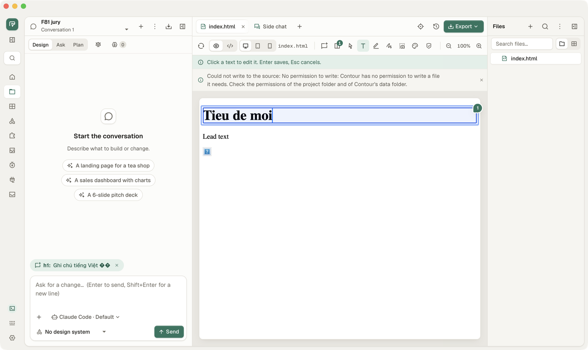
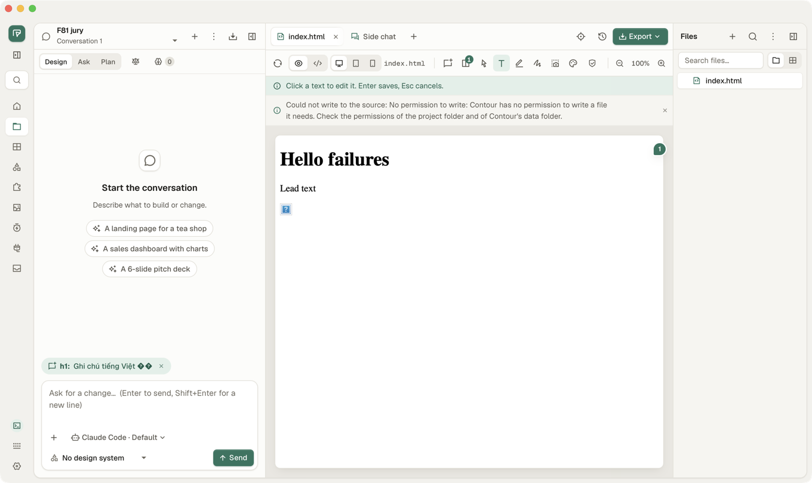
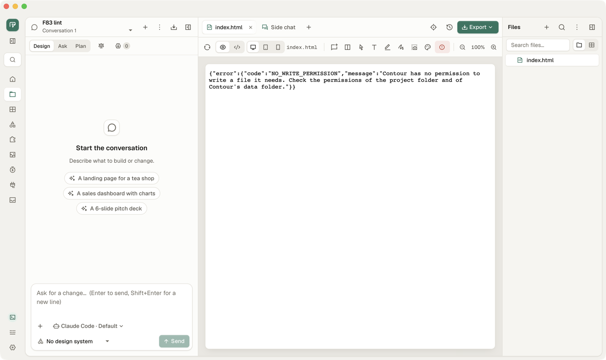
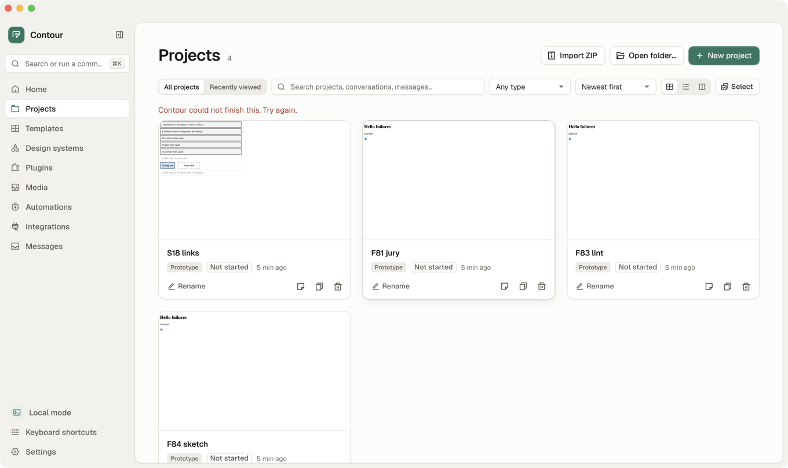

# QA bugs: desktop app 0.2.0-beta.32

Recheck of QA-080 to QA-084 on the release asset
`Contour_0.2.0-beta.32_universal.app.tar.gz` (checksum matches
`SHA256SUMS`), [test-plan.md §18](test-plan.md#18-desktop-app-links-and-popups-from-a-design-manual)
on macOS, and a smoke of the main flow. macOS 26, Apple silicon, 2026-11-12.
The screen was checked unlocked first (`kCGSSessionOnConsoleKey = 1`, no
`CGSSessionScreenIsLocked`).

**QA-080 to QA-084 are fixed on the release, each checked with a real
failure, not a stubbed reply. Every §18 row passes on macOS. The smoke
passes. Four new bugs, none blocking: a file Contour cannot read is
reported as one it cannot write (QA-085), the preview shows that error as
raw JSON (QA-086), a failed inline text edit throws away what was typed
(QA-087), and duplicate or delete from Projects fails with "Contour could
not finish this." without saying what (QA-088).** No `panicked` line in the
app's log.

Severity: 🔴 data loss or main flow blocked · 🟠 wrong result or hard to
get out of · 🟡 poor or confusing message · 🔵 minor.

## Summary

| Severity | Count | IDs |
|---|---|---|
| 🔴 | 0 | |
| 🟠 | 0 | |
| 🟡 | 3 | QA-085, QA-086, QA-087 |
| 🔵 | 1 | QA-088 |
| **Total** | **4** | |

| ID | Sev. | Title | Found by | Status |
|---|---|---|---|---|
| QA-087 | 🟡 | A failed inline text edit puts the old text back: what the user typed is gone | manual, macOS window | New |
| QA-086 | 🟡 | A page Contour cannot read shows in the preview as raw JSON (`{"error":{"code":…}}`) | manual, macOS window | New |
| QA-085 | 🟡 | A file Contour cannot read is reported as "no permission to write" | manual, macOS window | New |
| QA-088 | 🔵 | Duplicate (and delete) on the Projects page fail with "Contour could not finish this. Try again.", not what failed | manual, macOS window | New |

## How it was run

As on beta.28 ([How it was run](bugs-desktop-beta28.md#how-it-was-run)):
the release asset renamed `ContourQA.app`, bundle id
`dev.contour.desktop.qa`, ad-hoc signed, its own `OD_DATA_DIR`, the opener
log as `OD_OPEN_COMMAND`, the mock agent on `PATH`, the binary run directly
to keep its log. Only that copy's pid was driven and quit (⌘Q); the
owner's Contour was not running and was not touched. `/api/version`:
`0.2.0-beta.32`, `macos`, `aarch64`.

Failures were made real, on the copy's own data:

- **Database locked**: `(echo "BEGIN EXCLUSIVE;"; sleep 150; echo "COMMIT;") | sqlite3 <data>/app.sqlite`.
  Every write waits out the 5 s busy timeout, then fails with "database is
  locked" (the reply the web suite stubs).
- **File not readable**: `chmod 000` on the file. **Folder not writable**:
  `chmod 555` on the project folder.

Tools: beta.24's [go.sh](desktop-beta24/go.sh), [step.sh](desktop-beta24/step.sh),
[cg.swift](desktop-beta24/cg.swift), [mkproj.sh](desktop-beta24/mkproj.sh),
[opener.sh](desktop-beta24/opener.sh); pages
[sec18.html](desktop-beta23/sec18.html), [links27.html](desktop-beta27/links27.html),
[dialogs25.html](desktop-beta25/dialogs25.html), [design-b.html](desktop-beta24/design-b.html).
New in [desktop-beta32](desktop-beta32/):
[open.sh](desktop-beta32/open.sh) (open a project by name from Projects),
[timer18.html](desktop-beta32/timer18.html) (`window.open` on load and on a
2 s timer), [nonweb.html](desktop-beta32/nonweb.html) (`file:` and `mailto:`),
[qa080.mjs](desktop-beta32/qa080.mjs). Every URL the app handed to the
browser: [opens.txt](desktop-beta32/opens.txt).

**Traps**: the desktop window cannot be narrower than 900 pt and ⌘+ zooms
only the preview, so the phone layout cannot be reached in the window;
QA-080 ran in Playwright WebKit at 390×844 on the copy's own daemon (same UI
bundle): `cd crates/od-ui/e2e && BASE=http://127.0.0.1:<port> node ../../../docs/qa/desktop-beta32/qa080.mjs <outdir>`.
The machine's Vietnamese input method (Telex) rewrites letters that
`cg type` sends as key presses ("for" became "fò", "S18" became "Á18");
search for names without Telex letters. `cg type` also splits an emoji
into two halves (`��`); that is the tool, not the app.

## Results

### QA-080 to QA-084 recheck

| Bug | Check | Expected | Result |
|---|---|---|---|
| QA-084 | Sketch with 2 strokes, `chmod 000`, reopen | says it could not be read, nothing saved over it | **Pass**: "Could not read this sketch. Nothing was saved over it." with Retry ([01](desktop-beta32/01-qa084-read-failed.png)) |
| QA-084 | … draw a stroke | the file is not touched | **Pass**: file unchanged (mode 000, same size) |
| QA-084 | … Send to chat | nothing sent | **Pass**: the button is off |
| QA-084 | `chmod 644`, Retry, draw | 2 strokes back; the third saves next to them | **Pass**: file holds 3 strokes ([02](desktop-beta32/02-qa084-retry.png)) |
| QA-083 | Open a page whose file is `chmod 000` | the Lint button stays and says the check could not run | **Pass**: red Lint button, panel says why, with Retry ([04](desktop-beta32/04-qa083-lint-panel.png)); the reason is wrong (QA-085) |
| QA-083 | `chmod 644`, Retry in the panel | lint runs | **Pass**: "No design issues found.", the preview comes back too |
| QA-081 | Design Jury on, database locked | plain message, switch back off | **Pass**: "Could not turn on the Design Jury. Try again." ([05](desktop-beta32/05-qa081-jury.png)) |
| QA-081 | Add comment (Vietnamese text), database locked; Add again after | plain message, note kept, second Add saves | **Pass**: "Could not save the comment. Try again." ([06](desktop-beta32/06-qa081-comment.png)); pin 1 after |
| QA-081 | New sketch, folder `chmod 555`; again after | no HTTP or "daemon"; no editor; second creates it | **Pass**: toast "No permission to write: …"; second makes `sketches/sketch.sketch.json` |
| QA-081 | Duplicate from Projects, database locked | plain message, no copy | **Pass** for the wording rule (no HTTP, no "daemon"), but it does not say what failed: QA-088 ([07](desktop-beta32/07-qa088-duplicate.png)) |
| QA-082 | Manual edit, h1 text, Apply with folder `chmod 555`; Apply again after | says the edit was not applied, text kept; second writes | **Pass**: "The edit was not applied: …" ([08](desktop-beta32/08-qa082-apply.png)); file has the new text after |
| QA-080 | 390×844, `/projects/nope`; and a project deleted while open on Chat | Files and Preview off or still say gone | **Pass** both: tabs off, "This project was deleted or the link is wrong." stays, Chat stays picked ([wrong link](desktop-beta32/qa080-wrong-link.png), [deleted](desktop-beta32/qa080-deleted-live.png)) |

### §18 links and popups (macOS window)

| §18 item | Expected | Opens | Result |
|---|---|---|---|
| on_new_window always Deny: LK `target="_blank"`, CM ⌘-click, C0 `window.open` | no second app window; web address to the browser | 1 each to the opener; only the main window listed; log `blocked a new window` | **Pass** |
| … `file:` by `window.open` and by link, `mailto:` | nothing | 0, 0, 0 | **Pass** |
| 1 click = 1 tab: J (`pointerup`, `mouseup`, `click`), 3 clicks | 1 each | 1, 1, 1 (`J-pointerup`) | **Pass** |
| … L1 checkbox in a label, L3 label around a checkbox | 1 each | 1, 1 | **Pass** |
| Enter on K (`keydown` and `keyup`) twice; held Enter; Space | 1 each | 1, 1, 1, 1 (`K-keydown-1`) | **Pass** |
| `window.open` on load and on a 2 s timer | 0 | 0 ("timer fired" in the page) | **Pass** |
| Tab out of L to the app, Shift+Tab back into L (`keyup` opens) | 0 | 0; the page saw `Lku:Tab`, focus back in L | **Pass** |
| Typing `e` in L (control) | 1 | 1 (`L-keyup-e`) | Pass |
| Comment mode: click J | picks it, 0 | 0, comment box on `<button> J …` | **Pass** |
| M `confirm` then open, OK | dialog; 1 | dialog, 1 (`M-confirm`) | **Pass** |
| N `alert` then open; O `prompt` then open, OK | dialog; 1 each | 1 (`N-alert`), 1 (`O-prompt-x`) | **Pass** |
| After M: lone keyup in L | 0 | 0 (`Lku:b`) | **Pass** |
| Enter in P (`alert` on `keydown`), close with Enter, lone keyup in L | dialog; 0 | dialog shown; 0 (`Lku:c`) | **Pass** |
| Drag Q onto the drop zone, lone keyup in L | drop works; 0 | "dropped Q"; 0 | **Pass** |
| JS dialogs: `alert`, `confirm` OK / Escape, `prompt('Name?','x')` OK / Escape | "This page says"; `true`/`false`; `"x"`/`null`; page waits | A1 back after 2.9 s; `C1=true`, `C1=false`; `P1="x"`, `P1=null` | **Pass** |
| 5000-character alert | first 2000 and `…`, buttons on screen | OK on screen, text scrolls; the end (`…`) not checked this time | **Pass** (buttons) |
| `prompt('Tên?')`, type `Nguyễn Văn An ở Hà Nội`, OK | the page gets exactly that | `len=22 eq=true` ([11](desktop-beta32/11-prompt-vietnamese.png)) | **Pass** |
| Alert loop: first without checkbox, next with it; tick, OK | no more dialogs; `confirm` `false`, `prompt` `null` | checkbox from the second ([12](desktop-beta32/12-loop-checkbox.png)); `LOOP done n=40`, `C2=false 0ms`, `P2=null 1ms`; app answers | **Pass** |
| … ⌘R | dialogs show again | A1 dialog shown | **Pass** |
| Blocked in A, open B (no reload), `confirm('Delete?')` OK; back to A | B shows it, `true`; A shows again | dialog in B, `B=true`; A1 dialog in A | **Pass** |

Windows (WebView2) and Linux (WebKitGTK): not run, no such machine here.

### Smoke

| Flow | Result |
|---|---|
| New project, name `  Dự án smoke beta32  ` | **Pass**: created, spaces trimmed, Studio opens. macOS's "period with double-space" turned the two trailing spaces into `.` (system text setting in WKWebView fields, not Contour) |
| Chat with the mock agent | **Pass**: turn 1 writes `index.html` (v1), "Done 1 file written", Next chips |
| Preview | **Pass**: page shown, reloads by itself |
| Export ▸ HTML (single file) | **Pass**: save panel, file holds the page plus the standalone manifest |
| Help ▸ Check for Updates | **Pass**: "You're up to date. Version 0.2.0-beta.32 is the newest." ([13](desktop-beta32/13-up-to-date.png)) |

## QA-087 🟡 A failed inline text edit throws away what was typed

**Steps**
1. Open a page, pick the Text tool ("Click a text to edit it. Enter saves").
2. Make the write fail (here: project folder `chmod 555`; also a locked
   database or a full disk).
3. Click the h1, replace its text with "Tieu de moi", press Enter.

**Expected**: says the edit was not saved and keeps "Tieu de moi" on the
page (or in the field) so Enter can try again, as Manual edit does
(QA-082: "The edit was not applied", text kept).
**Actual**: the note "Could not write to the source: No permission to
write: …" shows, the preview reloads, and the heading is back to "Hello
failures". What was typed is gone; the user has to type it again.

**Where**: `crates/od-ui/src/app/preview_tools.rs:663-667`: on `Err` the
text edit calls `self.reload_preview()`, which drops the edited text. Keep
the text (an override, as on success) and let Enter retry; reload only on
success or when the user cancels. The note also says "permission to write"
twice ("No permission to write: Contour has no permission to write…"):
`failed_to(T::SaveFailed, …)` wraps a message that already names it.

## QA-086 🟡 A page Contour cannot read shows in the preview as raw JSON

**Steps**: make a project's `index.html` unreadable (`chmod 000`; also a
file the agent wrote with odd permissions, or a folder opened with Open
folder… owned by another user), open the project.

**Expected**: the preview says the page could not be opened, in words,
with a way to retry (as the Lint panel does).
**Actual**: the preview frame shows the daemon's reply:
`{"error":{"code":"NO_WRITE_PERMISSION","message":"Contour has no
permission to write a file it needs. …"}}`.

**Where**: `crates/od-server/src/routes/preview.rs` (the `scoped` handler
for `/api/projects/{id}/preview/{scope}/{*path}`) answers a failed read
with the API's JSON error, and the frame shows it as the page. For a
document request (the frame's navigation) answer an HTML error page, or
have the Studio check the reply and show its own state. Commit `c23ad0d3`
(after beta.32) hides raw proxy pages in read banners, not in the frame.

## QA-085 🟡 A file Contour cannot read is reported as "no permission to write"

**Steps**: as QA-086; open the Lint panel, or call
`GET /api/projects/<id>/lint/index.html`.

**Expected**: says Contour cannot read the file.
**Actual**: 403 `NO_WRITE_PERMISSION`, "Contour has no permission to
write a file it needs. Check the permissions of the project folder and of
Contour's data folder." The Lint panel shows "Lint failed: Contour has no
permission to write a file it needs. …" ([04](desktop-beta32/04-qa083-lint-panel.png)).
The user looks for a write problem where there is none.

**Where**: `crates/od-store/src/error.rs:94`: every `io::ErrorKind::PermissionDenied`
becomes `StoreError::NoWritePermission`, reads included. Map a denied
read to its own variant ("Contour cannot read …") at the read sites
(`read_file`), or name the operation in the message.

## QA-088 🔵 Duplicate and delete on Projects fail without saying what failed

**Steps**: Projects, press Duplicate on a card while the database is
locked.

**Expected**: "Could not duplicate the project. Try again." (QA-081's
rule: say what did not happen).
**Actual**: "Contour could not finish this. Try again." at the top of the
list. No copy is made, so nothing is lost.

**Where**: `crates/od-ui/src/app/projects.rs:870` (duplicate) and `:879`
(delete) set `page.error` to `e.to_string()`; use `api::failure` with the
action's message. The same `error.set(Some(e.to_string()))` is in 24 places
in `crates/od-ui/src` (6 in `projects.rs`: lines 126, 227, 859, 870, 879,
1017); each shows the generic text when the call fails.
