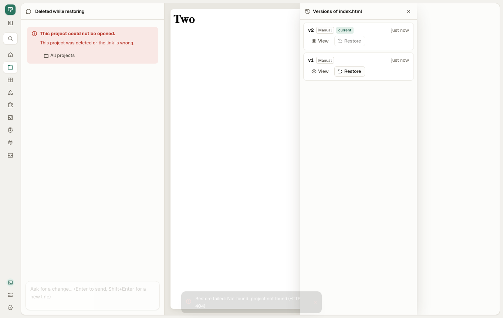
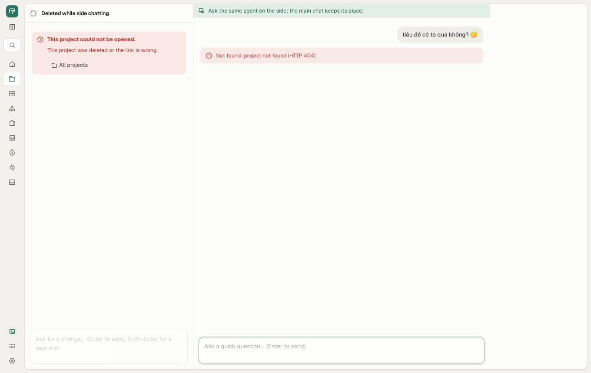
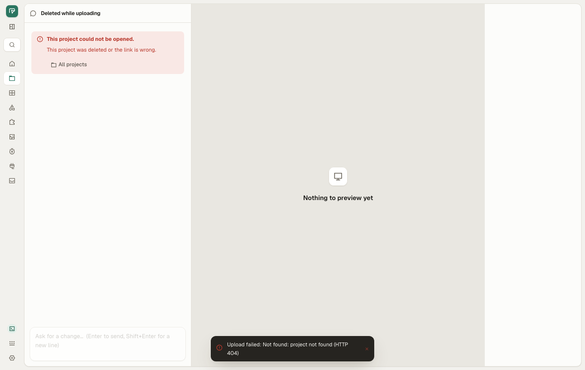
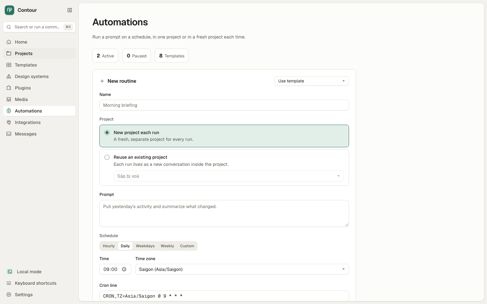
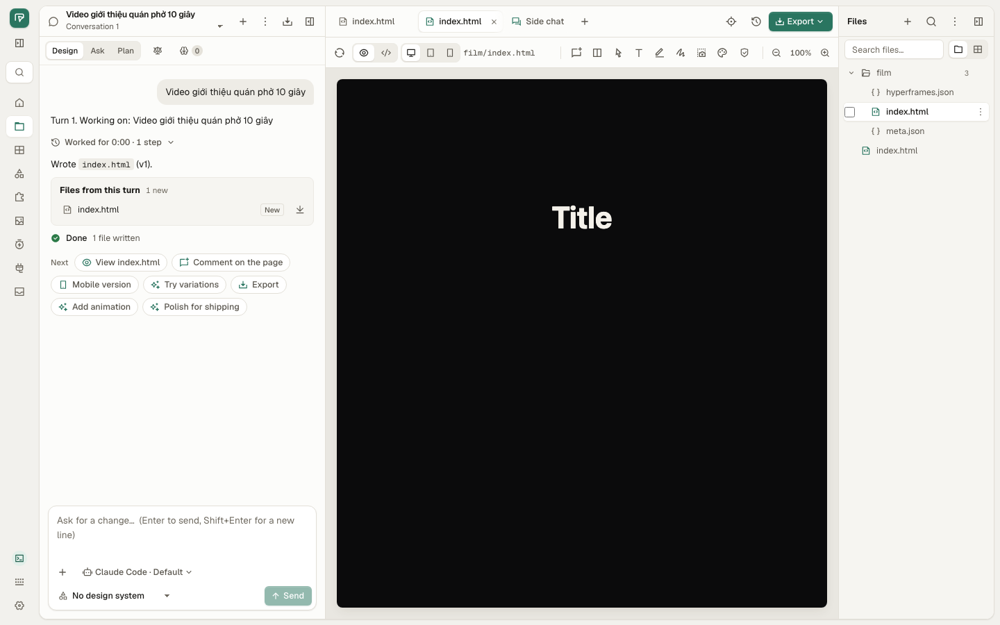
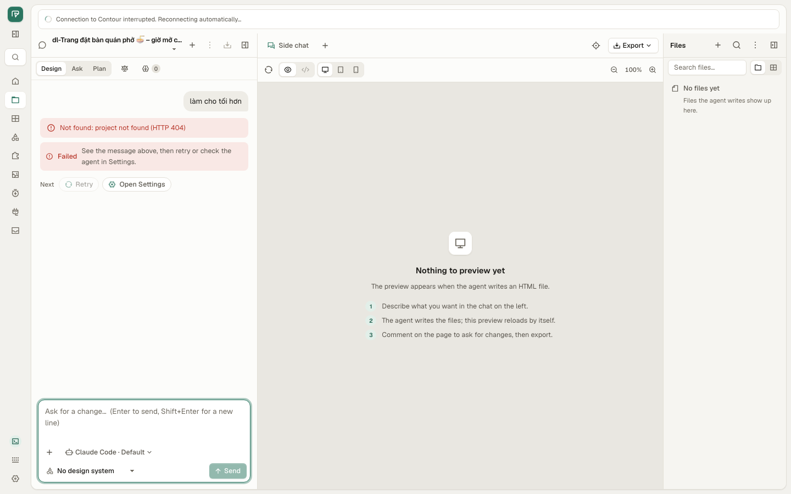
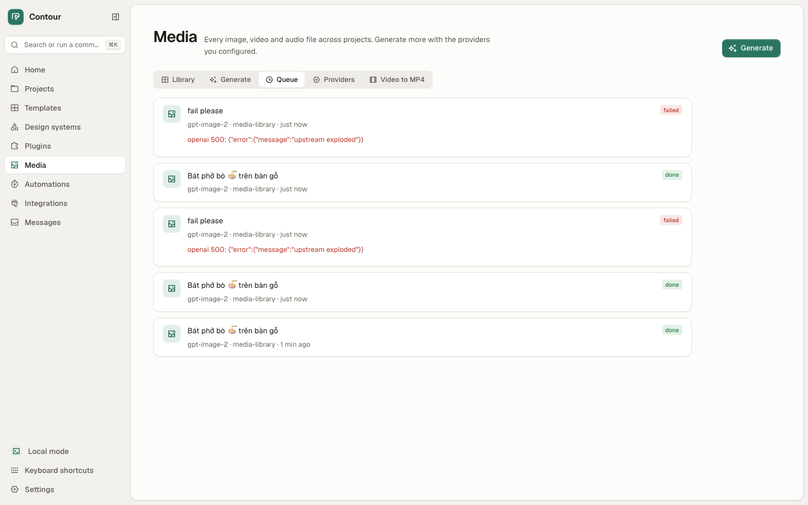
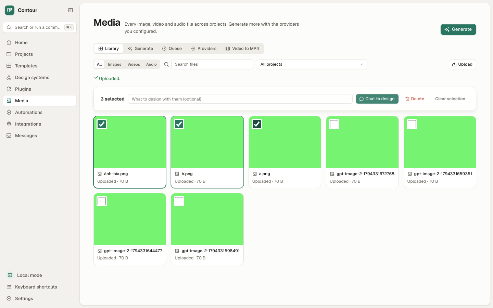

# QA bugs: web app after 0.2.0-beta.28

Broad pass over the web UI on `main` at 90127aad (after beta.28), against
[test-plan.md](test-plan.md) §1–16 (the desktop §17–19 were done in
[bugs-desktop-beta28.md](bugs-desktop-beta28.md)), 2026-11-11, time-boxed
to 2 hours. Chromium (Playwright) at 1440×900 and 390×844, macOS 26,
Chrome and ffmpeg installed.

**The main flows work end to end: first-run setup, a project from a
template, chat, preview, manual edit, export to HTML, ZIP, PDF and MP4,
Media generate and library, projects, settings in Vietnamese and Japanese,
automations. Five new bugs, none blocks a flow: one 🟠 (Add routine pressed
twice saves two routines), three 🟡 messages, one 🔵 label.** The QA suite
had 6 red tests; 5 were stale tests (fixed here), 1 needs an installed
beta.17 app.

Severity: 🔴 data loss or main flow blocked · 🟠 wrong result or hard to
get out of · 🟡 poor or confusing message · 🔵 minor.

## Summary

| Severity | Count | IDs |
|---|---|---|
| 🔴 | 0 | |
| 🟠 | 1 | QA-074 |
| 🟡 | 4 | QA-075, QA-076, QA-077, QA-079 |
| 🔵 | 1 | QA-078 |
| **Total** | **6** | |

| ID | Sev | Bug | Test | Status |
|---|---|---|---|---|
| QA-074 | 🟠 | Add routine pressed twice saves two identical routines; each runs on the schedule | `automations.qa.mjs` AUT-07 | Closed (beta.30) |
| QA-075 | 🟡 | Back in the Studio during an MP4 export, nothing says it is still exporting; a second press renders and downloads it again | `export.qa.mjs` EXP-14, EXP-15 | Closed (beta.30) |
| QA-076 | 🟡 | Sending in a project deleted from another tab says "Connection interrupted", "HTTP 404" and "check the agent in Settings" | `projects.qa.mjs` PRJ-13, PRJ-14, PRJ-15 | Closed (beta.30); the panels' part is QA-079 |
| QA-077 | 🟡 | A failed Media generation shows the provider's raw JSON; a refused key (401) does not point to Providers | `library.qa.mjs` LIB-15, LIB-18 | Closed (beta.30) |
| QA-078 | 🔵 | Images generated on the Media page are labelled "Uploaded" in the Library | `library.qa.mjs` LIB-16 | Closed (beta.30) |
| QA-079 | 🟡 | A project deleted from another tab: the Files panel, Versions and side chat stay open beside the not-found state and show "Not found: project not found (HTTP 404)" | `projects.qa.mjs` PRJ-16, PRJ-17, PRJ-18 | Open (beta.30) |

## Pass / fail by flow

| Flow | Suite (auto) | By hand | Result |
|---|---|---|---|
| First-run setup | ONB 14/14 | Continue pressed twice lands on Home once | Pass |
| Project from a template | HOME 15/15, TPL 21/21 after the test fix | Template + "Trang đặt bàn quán phở 🍜 – giờ mở cửa 6h–22h", Create pressed twice: one project, name and message intact | Pass |
| Chat and runs | CHAT 12/12, TF 13/13, RES 4/4 | Follow-up turn with a custom model | Pass |
| Preview and manual edit | STU 16/16, DL 25/25 | — | Pass |
| Export | EXP 12/12 | HTML, ZIP (pressed twice: one file), PDF, MP4 of a Motion film (34 s) | Pass, except QA-075 |
| Media | LIB-08/09/11/14 | Providers save (pressed twice), generate (pressed twice: one task), leave mid-generation (it finishes), upload 3 incl. `ảnh bìa.png`, select 3 ▸ Delete asks first; offline: prompt kept, nothing deleted, plain message | Pass, except QA-077, QA-078 |
| Projects and Library | PRJ 12/12, LIB 14/14 | ZIP import twice quickly: one project; search "  phở  " | Pass, except QA-076 |
| Settings | SET 10/10 | Model "  claude-sonnet-x  " trimmed, kept after reload, used by the Studio; language offline: error under Language | Pass |
| Languages | SET-01 | vi and ja (SOV) on 7 screens at 390 and 1440: axe clean (incl. `label-content-name-mismatch`), no sideways scroll; no English app string on Media, Studio and Automations (looked at by eye) | Pass |
| Automations | AUT 6/6 | Run now pressed twice: one run (409 for the second) | Pass, except QA-074 |
| Reference videos, MCP | REF 29/31 → 30/31 after the test fix, MCP 2/2 | — | REF-27 needs beta.17 installed (see below) |

`shoot` at 390 and 1440 (Home, Projects, Media, Settings, Automations,
Templates, Studio; en, vi, ja): no axe violation, no console error, no
sideways scroll. Its only note is touch targets under 44 px at 390
(tabs and segmented controls, 28 px high), the desktop density the app
uses everywhere; not filed.

## Red tests that were the test's fault (fixed here)

| Test | Why it went red | Fix |
|---|---|---|
| TPL-01, TPL-02, TPL-04 | Read card names from `aria-label`, removed in 46a79c01 (axe 4.14: the name comes from the shown text) | Read `.template-name` |
| TPL-16 | Expected a remixed film tagged "Media"; 3e39debd (UI-013) tags films "Motion", as a film started from the Motion chip or Use template is | Expect "Motion"; plan row updated |
| REF-19 | Counted "Reference ready" in `innerText`; since 30fd2efb the line said between two tool calls folds into the closed "Worked for … steps" group | Count in `textContent`; the two reference folders were always right |

REF-27 stays red on this machine: it needs `/Applications/Contour.app` at
beta.17, and the installed one is beta.26. Not a product bug. It (and
REF-31, which runs the same app) now skips with that reason when the
installed app is not beta.17.

## How it was run

```sh
# the QA suite (207 tests, ~15 min)
QA_SKIP_BUILD=1 crates/od-ui/e2e/qa/run.sh
# by hand: own daemon, data and HOME in a scratch folder, mock agent on PATH
OD_DATA_DIR=<tmp>/data HOME=<tmp>/home OD_UI_DIST=crates/od-ui/dist \
  OD_RESOURCE_ROOT=content OD_OPEN_COMMAND=/usr/bin/true OD_RESCAN_INSTALL_DIRS=0 \
  PATH=crates/od-ui/e2e/qa/mock-agent:crates/od-ui/e2e/mock-agent:/usr/bin:/bin:/opt/homebrew/bin \
  od daemon start --port 7490
```

Media used a loopback stand-in for OpenAI Images (the one in LIB-15:
"fail" → 500, "badkey" → 401, else a 1×1 PNG). MP4 used a composition
from `od media scaffold --duration 3`. Network loss was simulated by
aborting `/api/` requests in the browser. The owner's Contour and its data
were not touched.

## Recheck on v0.2.0-beta.30 (2026-11-11)

Built from the tag `v0.2.0-beta.30` (20a83e5b): `trunk build` and
`cargo build -p od-cli`, Chromium (Playwright) at 1360×860, the real `od`
daemon with the mock agents and loopback stand-ins for OpenAI Images and
fal's queue. **Four of five closed; QA-076 is closed for the chat, the
stream and the composer, but the side panels still show the bare 404:
filed as QA-079.**

| ID | Result | Evidence |
|---|---|---|
| QA-074 | Closed | AUT-07 passes: Add double-clicked, one routine |
| QA-075 | Closed | EXP-14 now also asserts "Exported" and one `.mp4` download (one render); new EXP-15: left for good, the file arrives once on Projects |
| QA-076 | Closed (chat) | PRJ-13, PRJ-14, PRJ-15 pass: send, idle stream and composer attachment switch to "This project was deleted or the link is wrong."; Files panel, Versions and side chat also switch, but see QA-079 |
| QA-077 | Closed | LIB-15 now asserts the 401 names OpenAI and has **Set up providers**, which opens the OpenAI key; new LIB-18: fal.ai answering 401 `{"detail": …}` reads "fal.ai returned an error: Invalid key: …", no raw JSON or `fal submit 401`, Set up providers opens the fal.ai key |
| QA-078 | Closed | LIB-16 passes: a generated image says "Generated", an upload "Uploaded" |

Suites touched, run whole: projects 15/18 (3 known: QA-079), library
18/18, automations 7/7, export 14/14.

```sh
QA_SKIP_BUILD=1 crates/od-ui/e2e/qa/run.sh projects   # likewise library, automations, export
```

## QA-079 🟡 A project deleted from another tab: the side panels show "Not found … (HTTP 404)"

Found while rechecking QA-076 on beta.30.

**Steps**
1. Open a project in tab A; open History (or the Side chat tab).
2. Delete the project in another tab (`DELETE /api/projects/:id`).
3. In tab A: Restore v1 in History, or ask in the side chat, or upload in
   the Files panel.

**Expected**: the Studio's not-found state as STU-12, and nothing else that
reads as a fault of Contour: no bare 404, no panel still offering Restore
or a side composer for a project that no longer exists.
**Actual**: the chat pane switches to "This project was deleted or the link
is wrong." with All projects, but the right side stays as it was: the
History panel with Restore buttons and a toast "Restore failed: Not found:
project not found (HTTP 404)"; the side chat with its composer and the turn
"Not found: project not found (HTTP 404)"; the Files panel's toast "Upload
failed: Not found: project not found (HTTP 404)". The preview of the
deleted page also stays.





**Cause**: `StudioCtx::failed` (`crates/od-ui/src/app/studio.rs:1313`)
probes the project but still returns `e.to_string()`, which every caller
shows; and only `chat_view.rs` reads `load_gone`, so the workspace
(preview, Files, Versions, side chat) is never told. **Fix**: when
`load_gone` is set, close or empty the workspace pane as for a wrong link,
and have `failed` return the ProjectGone text (or nothing) on a 404 for the
project. Same pattern at every `ctx.failed(&e)` site (92a9fcd1): files
panel, versions, side chat, memory, Design Jury, transcript export,
comments, manual edits, lint, sketches, GenUI, duplicate, export toast;
only the three above are covered by a test.

**Test**: `projects.qa.mjs` PRJ-16 (now also asserts no bare 404),
PRJ-17, PRJ-18, all `knownBug: 'QA-079'`.

## QA-074 🟠 Add routine pressed twice saves two identical routines

**Steps**
1. Automations ▸ New routine: name, prompt, a project, Hourly.
2. Double-click Add routine.

**Expected**: one routine. **Actual**: two with the same name, both
active ("2 Active"); each runs the agent on the schedule, so every hour
the prompt runs twice in the project.



**Cause**: `submit` (`crates/od-ui/src/app/automations.rs:425`) has no
in-flight guard; the second click posts again before the first reply
resets the form. **Fix**: a `saving` signal that disables Add and returns
early while the POST is out. Other forms checked the same way: project
location Add (one location), skill Save (the daemon refuses the second
with 409), New project (one), Remix (TPL-15), Create on Home (HOME-05):
only routines duplicate.

**Test**: `automations.qa.mjs` AUT-07.

## QA-075 🟡 MP4 export left and come back: nothing says it is still exporting

**Steps**
1. A Motion film open in the Studio (`film/index.html`), Export ▸ MP4 video.
2. While "Exporting mp4…" shows, click Projects, then the browser's Back.
3. Export ▸ MP4 video again.

**Expected**: the Studio still shows the export running (the work goes on
in the daemon, as it should), so the user waits. **Actual**: no status;
the chat's "Done" is the only status line. Pressing MP4 again renders a
second time and the browser gets two `index.mp4` downloads.



**Cause**: the toast's `status` and `busy` are signals local to the
Export menu (`crates/od-ui/src/app/export_menu.rs:274`), made fresh when
the Studio mounts again; the export itself goes on and its download still
arrives. **Fix**: keep running exports per project and file in app-level
state, show them on return, and join (or refuse) a second export of the
same file while one runs.

**Test**: `export.qa.mjs` EXP-14.

## QA-076 🟡 A project deleted from another tab: the chat blames the connection and the agent

**Steps**
1. Open a project in tab A.
2. Delete it elsewhere (tested with `DELETE /api/projects/:id`, the call
   Projects ▸ Delete makes in another tab).
3. In tab A, send "làm cho tối hơn".

**Expected**: as STU-12, "This project was deleted or the link is wrong."
with All projects. **Actual**: a banner "Connection to Contour
interrupted. Reconnecting automatically…" (the daemon is fine), the turn
"Not found: project not found (HTTP 404)", then "Failed — See the message
above, then retry or check the agent in Settings." with Retry and Open
Settings. None of these says what happened or where to go. Before any send
the tab shows nothing at all, which is acceptable.



**Where**: the project event stream's 404 is taken as a dropped link
(`recovery_tip.rs`, `on_project_link`), and a run refused with 404 is
classified `FailCause::Agent` (`chat_view.rs:737`, `RunFailedHint`). A 404
for the project should switch the Studio to its not-found state.

**Test**: `projects.qa.mjs` PRJ-13 (deleted as the message goes), PRJ-14
(deleted while the Studio is idle: its event stream ends).

## QA-077 🟡 A failed Media generation shows the provider's raw JSON

**Steps**
1. Media ▸ Providers: an OpenAI key and base URL. Generate an image.
2. The provider answers 500, or 401 for a wrong key.

**Expected**: the reason in words ("OpenAI refused the request: upstream
exploded"), and for 401 a pointer to Providers to fix the key (as the
"Needs a key" note does, LIB-09). **Actual**: the Queue row reads
`openai 500: {"error":{"message":"upstream exploded"}}` and
`openai 401: {"error":{"message":"Incorrect API key provided"}}`, with no
way to Providers. There is no Retry on a failed row either.



**Where**: the daemon stores the body as `error` (`openai 500: <body>`);
pull `error.message` out of a JSON body there, and in `media_page.rs`
add a Providers button for 401/403.

**Test**: `library.qa.mjs` LIB-15.

## QA-078 🔵 Generated images are labelled "Uploaded" in the Library

**Steps**: generate an image on Media ▸ Generate, open Library.

**Expected**: the card says where it came from (generated, or the model),
as the Library collects "every generated or uploaded asset" (features.md).
**Actual**: "Uploaded · 70 B", the same as a file the user uploaded; the
name is `gpt-image-2-<timestamp>.png`, so the prompt is nowhere.



**Cause**: `media_page.rs:423` shows `T::Uploaded` for every asset in the
`media-library` project, and Generate saves there too.

**Test**: `library.qa.mjs` LIB-16.
