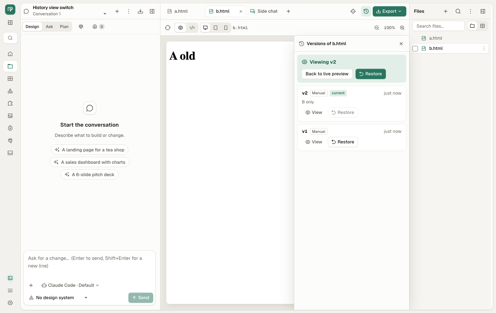

# QA bugs: web app after the beta.34 redesign (PR #171–#180)

Pass over the web UI on `main` at 15b98f97 (tasks tied to their owner,
StudioPhase Gone, ReadState and Autosave, ShellState, bridge press and
shadow DOM), 2026-11-13. Chromium (Playwright) for the QA suite, Chromium
and WebKit for the bridge; macOS 26. Scenarios: [test-plan.md](test-plan.md)
§21 (`leave.qa.mjs`) and STU-20…STU-22 (`studio.qa.mjs`).

**No regression of PR #171–#180 found: the whole QA suite passes (252
tests; CHAT-06 was a harness race, fixed here) and the bridge e2e passes on
both engines. Four bugs, all older than the redesign but in the areas it
touched: a late History answer sibling of 38c03f1a (QA-089), the autosave
not run when the page unloads (QA-090), a panic when a focused editor goes
(QA-091), and a daemon that always takes 5 s to stop with a tab open
(QA-092).**

Severity: 🔴 data loss or main flow blocked · 🟠 wrong result or hard to
get out of · 🟡 poor or confusing message · 🔵 minor.

## Summary

| ID | Sev | Bug | Test | Root cause |
|---|---|---|---|---|
| QA-091 | 🟠 | A Markdown editor or a sketch's text label that has the focus when its view goes (Ctrl+Tab, Ctrl+W, Ctrl+1…9, project deleted elsewhere) panics in its `blur` handler; the sketch label is lost | `leave.qa.mjs` LV-05, LV-10, LV-11, LV-14 | `on:blur` reads signals already disposed |
| QA-090 | 🟠 | Markdown typed or a sketch stroke drawn less than 700 ms before a reload, a tab close or a Back to another page load is lost | `leave.qa.mjs` LV-03, LV-04, LV-16 | no save on `pagehide` |
| QA-089 | 🟠 | History: View on a version of file A, then file B picked before it loads: B's tab shows A's version, "Viewing vN" and a Restore that fails with "Not found: version not found" | `studio.qa.mjs` STU-21 | `view_version` answer applied without checking the file is still shown |
| QA-092 | 🔵 | Stopping the daemon (quit, update, restart) takes 5 s whenever any tab of the app is open, and logs "responses still open at shutdown" | `leave.qa.mjs` LV-17 | event streams (`/api/memory/events`, project `/events`) never end on shutdown |

## Pass / fail by area

| Area (PR) | Auto | Result |
|---|---|---|
| Whole QA suite, 21 files (Chromium) | 252 tests: 247 pass, 2 skip (need beta.17 installed), CHAT-06 red (harness, fixed), STU-20 red (new test, fixed) | Pass |
| Bridge e2e + press table (Chromium, WebKit) | `bridge.e2e.mjs` rc 0; press table 28 rows, 8000 sequences | Pass |
| Tasks tied to owner (#171…) | LV-06 History closed while loading, LV-08 upload then leave, LV-09 Media generate then Library and Home, LV-13 a file deleted while typing, LV-15 brief sent from focused composer | Pass |
| ReadState / Autosave (#179) | LV-01 switch file while typing, LV-02 failed save saved on tab close, LV-12 in-app Back while typing; LV-03, LV-04, LV-16 unload | Pass, except QA-090, QA-091 |
| History late answer (38c03f1a) | STU-20 list (new), LV-07 A → B → A | Pass; View is QA-089 |
| StudioPhase Gone | PRJ-13…PRJ-25, FAIL-06, FAIL-13 (suite); LV-05 typing in a deleted project | Pass, except QA-091 |
| Bridge press + shadow DOM (#178) | 3 new table rows (below), STU-22 link and `window.open` in a shadow root in the web preview | Pass |

## How it was run

```sh
crates/od-ui/e2e/qa/run.sh                                 # all suites, ~25 min with the build
QA_SKIP_BUILD=1 crates/od-ui/e2e/qa/run.sh leave           # §21, ~1.5 min
QA_SKIP_BUILD=1 QA_ONLY='STU-2[0-2]' crates/od-ui/e2e/qa/run.sh studio
node crates/od-ui/e2e/bridge.e2e.mjs                       # Chromium and WebKit, press table first
node bridges/press.test.mjs
```

## QA-091 🟠 A focused editor that goes panics in its blur handler

**Steps (LV-10):** open `notes.md` in Split, type a few letters, press
Ctrl+Tab (or Ctrl+W, Ctrl+1…9, or delete the project from another tab).

**Expected:** the next tab shows, the text is saved, nothing in the console.

**Actual:** the console shows a Rust panic:

```
panicked at reactive_graph-0.2.3/src/traits.rs:755:45:
At crates/od-ui/src/app/file_state.rs:151:28, you tried to access a reactive
value which was defined at crates/od-ui/src/app/file_state.rs:118:20, but it
has already been disposed.
```

The Markdown text is still saved (the view's cleanup flush runs first) and
in Chromium the app keeps working after it. A sketch's text label typed
with the Text pen and not yet committed (LV-14) is lost: its `blur` handler
(`commit_text`) panics before it adds the stroke (`traits.rs:361`).

**Why:** Chrome fires `blur` on a focused element when it is removed from
the page, and Leptos removes the DOM after it disposed the owner. The
keyboard shortcuts of the Studio (`studio.rs` `on_key`: `w`, digits,
Ctrl+Tab) work while a text field has the focus, so the editor still has it
when its view goes.

**Where:** `doc_view.rs:239` `on:blur=move |_| autosave.save_now()` →
`file_state.rs:151` (`saves.get_value()`); `preview_tools.rs:1613`
`on:blur=move |_| commit_text()` → `text_at.get_untracked()`. Fix: guard
the handlers with `try_*` (or `Tasks::alive`), as the composer's blur does
for its own reads (`composer.rs:770`, but `cb.run(false)` there is the same
pattern; LV-15 did not reach it). Older than #179: `d5537f7d~1` had the
same `on:blur=move |_| save_now()` reading `save_seq.get_value()`.

**Same pattern, checked:** every `on:blur` in `crates/od-ui/src/app`:
`doc_view.rs:239` (bug), `preview_tools.rs:1613` (bug), `composer.rs:770`
(`Callback::run` on blur; not reproduced with Enter on Home),
`ds_page.rs:1233` (only `set`, which does not panic).

## QA-090 🟠 The autosave does not run when the page unloads

**Steps (LV-03, LV-04, LV-16):** type in `notes.md` (or draw a sketch
stroke), then within 700 ms reload the page, close the tab, or press Back
to a page that was a separate page load.

**Expected:** what was typed or drawn is saved, as when switching tab or
leaving the Studio inside the app. The original app flushes pending sketch
autosaves on `pagehide` and `beforeunload` (`FileWorkspace.tsx:1863`).

**Actual:** the file keeps its old content: `notes.md` is `# Notes\n`, the
sketch has `"strokes":[]`. The test pauses the page clock so the 700 ms
timer cannot fire; only a save on unload could keep it.

**Where:** `file_state.rs` `Autosave` saves on its timer, on blur and on
its owner's cleanup; nothing runs on `pagehide`. Fix: flush every pending
autosave on `pagehide` with a `keepalive` request (a plain fetch may be
cancelled by the unload). The leave guard (`leave_guard.rs`) does not count
a pending autosave in `would_lose`, so no "Leave page?" either.

## QA-089 🟠 History: a version viewed on the file just left shows over the new file



**Steps (STU-21):** a.html has versions "A old", "A new"; b.html has "B
only". Open a.html, History, View on "A old"; before it loads (slow
network), click b.html.

**Expected:** b.html's live page and its own versions; a.html's version is
dropped, as the History list itself does since 38c03f1a.

**Actual:** the tab is b.html, the panel says "Versions of b.html" and
"Viewing v2", the preview shows "A old" from a.html. Restore there posts
a.html's version id against b.html and says "Restore failed: Not found:
version not found" (raw wording, compare QA-081). b.html is not changed.

**Where:** `versions.rs:71` `view_version`: the panel stays mounted across a
file switch, so `tasks.spawn` keeps the task, and `ctx.viewing.set(…)` runs
for whatever file is shown by then. `show_tab` clears `viewing` only before
the answer. Fix: compare the file (or the `seq` the list uses) before
setting `viewing`. Sibling of 38c03f1a, missed by its grep.

## QA-092 🔵 The daemon takes 5 s to stop whenever a tab is open

**Steps (LV-17):** open Home in a tab, send SIGTERM to `od daemon` (what
quit, update and restart do).

**Expected:** it stops at once (13 ms with the tab closed).

**Actual:** 5.0 s every time, and the log says "responses still open at
shutdown; closing them". On Home, blocking `/api/memory/events` in the
page brings it to 26 ms. In the Studio, blocking only that stream or only
the project's `/events` stream still takes 5 s: each holds it.

**Where:** `routes/c2/memory.rs:221` `events` and the project event stream
(`routes/preview.rs`) keep their SSE open until the client leaves;
`serve_until` (`od-server/src/lib.rs:320`, `DRAIN_LIMIT`)
then waits its full 5 s. The memory toast (`memory_settings.rs:358`) opens
its stream on every screen but Settings. Fix: end the event streams on the
daemon's shutdown signal. Old (24 Oct); it turned CHAT-06 red because the
harness waited exactly 5 s and then respawned before the killed daemon was
gone (the harness now waits for the exit).

## New press rows (bridges/press.test.mjs) and their mutations

| Row | Guard (od-bridge.js) | Before the rows | After |
|---|---|---|---|
| open in pointerdown opens nothing | `OPENS[f.type] !== true` in `spend` | survived | red: 1 tab, want 0 |
| a held key's repeat leaves the mouse's press | `keydown`/`keyup` `repeat` in `spend` | survived | red: tab opened in the repeat `keydown` |
| two _blank clicks before settle: one tab, the second href | `h.link !== f.ev` in `settle` | survived | red: the tab opened on the first link |

The last two count right under the mutation (1 tab); each row also checks
which event (and so which link, which href) opened the tab.
