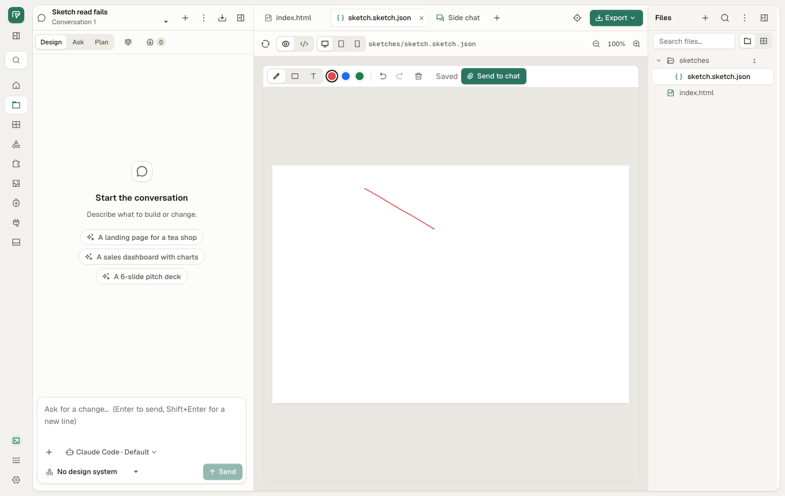

# QA bugs: when a call fails (web)

Pass over the error branches of eight Studio features that had no e2e test
for a failed call: Design Jury, comments, manual edit, lint, sketch, GenUI,
duplicate project and transcript export ([test-plan.md](test-plan.md) §20),
on `main` at 4910213c, 2026-11-11. Chromium (Playwright) at 1360×860,
macOS 26, real `od` daemon with the mock agents.

**Every feature recovers: in all 14 scenarios the same action works when
tried again and nothing the user typed is lost, except one: a sketch whose
read fails opens blank and its next stroke replaces the file (QA-084, 🔴).**
The other three bugs are messages: a failed call says "The daemon hit an
error: … (HTTP 500)" in seven places (QA-081), manual edit shows the bare
reason (QA-082), and a lint that could not run leaves no trace (QA-083).

Severity: 🔴 data loss or main flow blocked · 🟠 wrong result or hard to
get out of · 🟡 poor or confusing message · 🔵 minor.

## Summary

| ID | Sev | Bug | Test | Status |
|---|---|---|---|---|
| QA-084 | 🔴 | A sketch whose read fails opens as a blank sketch; the next stroke saves over the file and the earlier strokes are gone | `failures.qa.mjs` FAIL-10 | Open |
| QA-081 | 🟡 | A failed call reads "The daemon hit an error: database is locked (HTTP 500)" (Design Jury, comments, new sketch, GenUI, duplicate, transcript export) | `failures.qa.mjs` FAIL-01, 02, 03, 08, 11, 12, 14 | Fixed |
| QA-082 | 🟡 | Manual edit: a write that failed shows only the daemon's reason ("database is locked"), not that the edit was not applied | `failures.qa.mjs` FAIL-05 | Fixed |
| QA-083 | 🔵 | Lint that could not run leaves no trace: the Lint button disappears and nothing says the check failed | `failures.qa.mjs` FAIL-07 | Open |

## Pass / fail by feature

| Feature | Scenario | Retry works | Message | Result |
|---|---|---|---|---|
| Design Jury | FAIL-01 switch not saved, FAIL-02 Stop refused | yes (switch goes back off; Stop re-enabled) | "The daemon hit an error: … (HTTP 500)" | QA-081 |
| Comments | FAIL-03 Add fails | yes, note kept | "Could not save the comment: The daemon hit an error: … (HTTP 500)" | QA-081 |
| Comments | FAIL-04 list does not load | yes (Retry button) | "Could not load the comments" | pass |
| Manual edit | FAIL-05 write fails | yes, text kept | "database is locked" | QA-082 |
| Manual edit | FAIL-06 project deleted elsewhere | n/a | not-found state | pass |
| Lint | FAIL-07 lint fails | yes (Reload preview) | none: the Lint button is gone | QA-083 |
| Sketch | FAIL-08 new sketch not created | yes | "The daemon hit an error: … (HTTP 500)" | QA-081 |
| Sketch | FAIL-09 save fails | yes, both strokes saved | "Not saved" | pass |
| Sketch | FAIL-10 read fails | — | blank canvas, then "Saved" over the file | QA-084 |
| GenUI | FAIL-11 answer not sent | yes, question kept | "Could not send the answer: The daemon hit an error: … (HTTP 500)" | QA-081 |
| Duplicate | FAIL-12 copy fails | yes, no stray copy | "The daemon hit an error: … (HTTP 500)" | QA-081 |
| Duplicate | FAIL-13 project deleted elsewhere | n/a | not-found state, no copy | pass |
| Transcript export | FAIL-14 download fails | yes | "The daemon hit an error: … (HTTP 500)" | QA-081 |

## How it was run

```sh
QA_SKIP_BUILD=1 crates/od-ui/e2e/qa/run.sh failures   # ~40 s, after one build
```

The daemon's failure is a `page.route` that answers the one call with the
daemon's own 500 body (`{"error":{"code":"INTERNAL_ERROR","message":
"database is locked"}}`) until the test lifts it. Each test tries again
first, then checks the wording, so a test red only for its wording names
that bug alone. Run three times; FAIL-10 red 3/3.

## QA-084 🔴 A sketch whose read fails opens blank and the next stroke replaces it

**Steps**
1. Files ▸ New ▸ Sketch, draw two strokes; "Saved".
2. Reload. The read of `sketches/sketch.sketch.json` fails once (a 500, a
   lost connection, a file being written by the agent).
3. Open the sketch, draw one stroke.

**Expected**: the sketch says it could not be read and offers to try
again; nothing is written over the file. **Actual**: a blank canvas, as
for a new sketch. The stroke autosaves, the status says "Saved", and the
file now holds 1 stroke: the 2 earlier strokes are gone.



**Where**: `crates/od-ui/src/app/sketch.rs:86-89`: `Err(_) =>
SketchFile::blank()` treats a failed read as an empty sketch, and
`loaded` turns on the autosave. On `Err`, show the error with a retry and
keep `loaded` false; only a 404 for a file that never existed is blank.

**Test**: `failures.qa.mjs` FAIL-10.

## QA-081 🟡 A failed call reads "The daemon hit an error: … (HTTP 500)"

**Steps**: any of FAIL-01, 02, 03, 08, 11, 12, 14: the call answers 500.

**Expected**: what did not happen, in the user's words, as QA-029 set for
storage errors: no "daemon", no HTTP status. For example "Could not turn
on the Design Jury. Try again." **Actual**:
- Design Jury switch and Stop, new sketch, duplicate, transcript export
  (toast): "The daemon hit an error: database is locked (HTTP 500)".
- Comment (draft): "Could not save the comment: The daemon hit an error:
  database is locked (HTTP 500)".
- GenUI (card): "Could not send the answer: The daemon hit an error:
  database is locked (HTTP 500)".
- In Vietnamese the same is "Daemon bị lỗi: … (HTTP 500)".

The action itself recovers in every case (retry works, nothing lost).

**Where**: one root. `crates/od-ui/src/app/api.rs:35-38` (`Display for
HttpError`) appends `(HTTP {status})` to every error without a code, and
`i18n.rs:240` `ErrServer` says "The daemon hit an error". `StudioCtx::failed`
(`studio.rs:1315`) passes it through. Every caller that shows
`ctx.failed(&e)` or `e.to_string()` has it too, not only the seven tested:
files panel (upload, rename, delete, move), versions (restore), export
extras, memory menu, session mode, side chat, annotation save
(`preview_tools.rs:1274`), design-system handoff (`project_actions.rs:65`).
Fixing the `Display` covers them all; the tests above cover seven.

**Test**: `failures.qa.mjs` FAIL-01, FAIL-02, FAIL-03, FAIL-08, FAIL-11,
FAIL-12, FAIL-14.

**Fixed (unreleased)**: `HttpError`'s `Display` never shows the status,
and an internal failure (code `INTERNAL_ERROR`, or a 5xx with no code)
reads "Contour could not finish this. Try again."; the status and the
daemon's words go to the console (`api::error_of`). `api::failure` and
`StudioCtx::failed_to` say what was not done first ("Could not save the
comment. Try again."), used by the seven tested places and the files
panel, versions, memory, session mode and side chat. New sketch
(`sketch.rs`) and annotation save keep the plain `Display` text.

## QA-082 🟡 Manual edit: a failed write shows only the daemon's reason

**Steps**: Manual edit, pick the title, type a new text, Apply while
`POST …/source-edits` answers 500.

**Expected**: "The edit was not applied: …" (the text is kept, as it is).
**Actual**: the panel reads "database is locked" and nothing else; the
user cannot tell whether the edit went in. Apply again works.

**Where**: `crates/od-ui/src/app/manual_edit.rs:310` sets `e.message`
bare; `manual_edit.rs:228` does the same for the read of the picked
element (`manual-read-error`). `ManualHistoryFailed` (line 473) already
wraps its message; do the same for these two.

**Test**: `failures.qa.mjs` FAIL-05.

**Fixed (unreleased)**: apply, the element read and undo/redo use
`failed_to` ("The edit was not applied. Try again."); so does the
source write of the preview tools (`SaveFailed`).

## QA-083 🔵 Lint that could not run leaves no trace

**Steps**: open a page while `GET …/lint/index.html` answers 500.

**Expected**: the Lint button stays and says the check could not run
(the Lint panel already has an error state). **Actual**: the Lint button
is gone; nothing says the check failed. Reload preview runs it again, but
nothing tells the user to.

**Where**: `crates/od-ui/src/app/preview_tools.rs:764-771`: the badge is
built only from `Some(Ok(_))`, so `LintPanel`'s `Some(Err(e))` branch
(line 1101) can never be opened.

**Test**: `failures.qa.mjs` FAIL-07.
